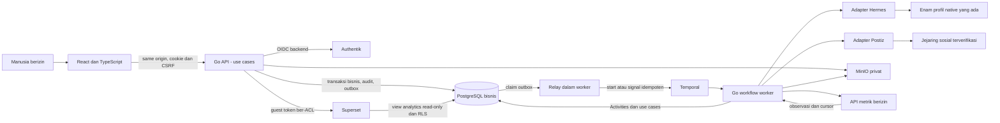

# Ikhtisar arsitektur

> **Usulan Phase 0 — belum diimplementasikan dan belum disetujui owner.** Dasar: prinsip [Phase 0](../PHASE-00-DISCOVERY-AND-ARCHITECTURE.md) dan acceptance [Phase 1–7](00-project-overview.md#peta-implementasi-dan-gate).

## Bentuk sistem yang diusulkan

Backend Go modular monolith menerapkan Ports and Adapters. React + Vite + TypeScript strict dan Tailwind menjadi usulan frontend; `net/http` dengan routing standar Go yang mendukung pola route menjadi pilihan awal backend, bukan framework besar. Versi Go/Node, library OIDC, migrator dan pin dependency baru dipilih pada Phase 1 berdasarkan compatibility dan support, bukan diklaim sudah terpasang. PostgreSQL diakses lewat `pgx` dan query yang dihasilkan `sqlc`; transaksi dan SQL tetap eksplisit.

Dua entry point aplikasi: **API** untuk HTTP/OIDC/UI dan **worker** untuk Temporal Activities/Workflows serta relay outbox yang terbatas tanggung jawabnya. Modul domain dipisah menurut capability bisnis, bukan menurut satu tabel atau satu vendor. Proses worker bukan microservice bisnis baru; domain dan use case sama, credential serta deployment dapat dipisahkan.

Diagram ini menunjukkan tanggung jawab yang direncanakan; bukan daftar layanan aktif. Diagram rinci: [context](architecture/system-context.md), [container](architecture/container-diagram.md), [component](architecture/component-diagram.md), [deployment](architecture/deployment-diagram.md), [alur](architecture/data-flow.md).

## Pembagian sumber kebenaran

| Komponen | Memiliki | Bukan pemilik |
|---|---|---|
| PostgreSQL bisnis | Identitas aplikasi/membership, ACL, brand, task/run, versi deliverable/konten/aset, approval, intent/job publikasi, integration mapping, audit, observasi metrik dan outbox | Password Authentik; runtime internal Hermes; workflow history Temporal |
| Authentik | Identitas provider dan autentikasi/MFA sesuai konfigurasi yang diverifikasi | Hak brand aplikasi atau auto-admin dari claim tanpa mapping disetujui |
| Temporal | Execution history, timer, retry, pause, cancellation dan recovery workflow | Catatan final bisnis atau otorisasi untuk menerbitkan |
| Profil Hermes existing | Eksekusi agen melalui mekanisme native yang dibuktikan | State bisnis authoritative, approval atau hak mengambil seluruh data brand |
| MinIO | Objek biner privat dan versi objek | ACL bisnis atau metadata master; presigned URL bukan identitas berkas permanen |
| Postiz | Operasi schedule/publish eksternal dan status provider | Approval atau source of truth konten internal; status sukses submit belum pasti published |
| Superset | Visualisasi dan konfigurasi dashboard | Pengumpulan data sosial; otorisasi hanya berdasarkan filter UI |
| Redis (opsional) | Cache/rate-limit non-authoritative bila terbukti perlu | Session master, queue workflow, lock correctness, atau pengganti outbox |

Temporal, Authentik, Postiz dan Superset memerlukan persistence masing-masing sesuai produk; jika berbagi satu PostgreSQL instance, database/role dan lifecycle-nya terpisah. Aplikasi tidak membaca tabel internal vendor. Sumber sosial boleh melaporkan hasil eksternal yang berbeda dari intent internal; rekonsiliasi menyimpan keduanya sebagai fakta berbeda, bukan menimpa histori.

## Batas sinkron dan asinkron

- HTTP sinkron: validasi, autentikasi/sesi, CSRF, otorisasi use case, transaksi PostgreSQL, respons resource/operation ID. Jangan menahan request selama agen bekerja atau publikasi berjalan.
- Asinkron: relay mengambil outbox setelah commit; Temporal menjalankan workflow; Activities mengakses port aplikasi, menyimpan run/hasil dan melakukan operasi eksternal dengan operation ledger.
- Webhook/polling: autentikasi sesuai capability aktual, dedupe inbox, korelasi melalui mapping server-side, simpan event dan outbox atomik; workflow menerima sinyal sebagai pemberitahuan lalu membaca fakta terbaru.
- Retry dispatch relay hanya mengirim event ke Temporal, bukan mengulang business side effect. Seluruh retry/cancellation/timer bisnis berada di Temporal; tidak menambah Celery, queue Redis atau cron orchestration kedua.

## Otorisasi end-to-end

Setiap use case menerima actor dan organization/brand context yang berasal dari sesi atau capability worker yang tersimpan, bukan dari payload mentah. User aktif perlu membership org, permission tindakan, dan grant brand. Handler bukan satu-satunya guard. Repository brand-scoped mewajibkan scope pada signature dan SQL; composite foreign keys mencegah referensi lintas organisasi/brand. List, detail, export, search, presigned URL dan token BI tunduk aturan sama.

Worker menerima ID resource, operation ID, dan principal service terbatas; resolve kembali grant requester/actor, status brand, agent grant, context policy, serta approval sebelum side effect. Pencabutan akses menghentikan aksi sensitif yang belum dikirim; operasi yang sudah diterima eksternal masuk reconciliation/cancel sesuai capability, bukan dianggap otomatis dibatalkan. Sebuah task tidak memberi akses permanen pada brand.

Sesi opaque tersimpan server-side dengan hash token, expiry dan revocation. State-changing request memerlukan CSRF token + pemeriksaan Origin yang sesuai. Default deny provisioning OIDC/invitation. Browser tidak memegang OIDC client secret, refresh token, MinIO credential atau Postiz/Superset admin credential.

## Data dan pengembangan bertahap

Model [domain](05-domain-model.md) dan [database](06-database-design.md) adalah target lintas fase. Migrasi Phase 1 hanya membuat foundation yang dibutuhkan; tabel Phase 3–6 bukan kewajiban dibangun sekaligus. Upload privat melalui quarantine, validasi dan kebijakan scan sebelum dapat dipakai dalam context atau publishing. Search awal menggunakan indeks/full-text PostgreSQL; embedding/RAG dan Redis memerlukan ADR serta evaluasi tambahan bila benar-benar perlu.

## Kontrak operasional

Log terstruktur hanya memuat ID korelasi, kode hasil dan metadata aman. Workflow history juga media penyimpanan sensitif: argumen berisi ID/ref, bukan token, raw prompt atau dokumen rahasia; batas retention/encryption dievaluasi. Readiness API memeriksa dependensi wajib sesuai mode, bukan mengklaim semua provider sehat; liveness tidak bergantung pada seluruh integrasi. Worker readiness memerlukan koneksi Temporal dan database; status provider/capability ditampilkan terpisah, tidak mematikan seluruh UI karena satu sumber sosial down.

RPO/RTO, SLO, beban pengguna/agen, batas upload, kapasitas dan headroom belum ditetapkan. Tidak ada hasil benchmark, restore, verifikasi OIDC/Hermes/Postiz atau klaim kesiapan produksi dalam blueprint ini. Persetujuan kapasitas dan compatibility integrasi menjadi gate sebelum implementasi terkait; produksi tetap diblokir sampai acceptance Phase 7 dan izin cutover owner.
