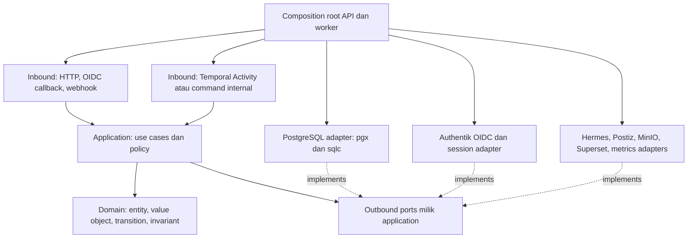

# Hexagonal Architecture — batas dan kontrak

> **Usulan Phase 0.** Nama package, interface dan operasi di bawah merupakan kontrak desain, bukan kode yang sudah dibuat.

## Aturan dependensi

Domain hanya mengenal tipe bisnis dan pustaka standar yang tidak membawa IO/framework; tidak mengimpor SQL, HTTP, OIDC, Temporal SDK, vendor SDK, atau kode generated sqlc. Application mengetahui domain dan interface port miliknya; adapter bergantung ke dalam, bukan sebaliknya. Bootstrap mengikat implementasi lewat constructor. Jangan membuat interface kosong atau interface untuk setiap struct jika belum ada boundary nyata.

## Modul yang diusulkan

| Modul | Domain/application | Boundary penting |
|---|---|---|
| identity | Membership, role/permission, brand policy, sesi dan invitation | IdentityProvider, SessionStore, AuthorizationPolicy, AuditWriter |
| brands | Profil, lifecycle, anggota, grant | Scoped repository; arsip tidak menghapus histori |
| agents | Registry enam profil, mapping, capabilities, readiness evidence | AgentGateway, CapabilityRegistry; tanpa implementasi agen LLM baru |
| work | Task/dependency, run, event, deliverable, revisi | TaskRepository, AgentGateway, ContextProvider, WorkflowDispatch |
| knowledge | Item/versi, persetujuan materi, konteks terpilih | KnowledgeRepository, ContextPolicy, ObjectStore, Search |
| media | Asset/versi, quarantine, validasi dan lifecycle | ObjectStore, FileInspector, MalwareScanner jika tersedia |
| campaigns/content | Campaign, draft/version, kalender rencana, manifest media | Repository scoped; material edit membuat versi baru |
| approvals/publishing | Intent immutable, keputusan, confirmation, job, rekonsiliasi | ApprovalRepository, Publisher, ExternalOperationLedger |
| analytics | Source mapping, cursor, definisi/observasi metrik, laporan | MetricsSource, AnalyticsRepository, DashboardTokenIssuer |

Application-level transaction dan outbox bukan domain vendor. Package common dibatasi pada ID, clock abstraction bila diperlukan, error dan transaction contract; jangan membuat `shared` yang menampung seluruh bisnis atau singleton service locator. Modul tidak memanggil tabel/adapters milik modul lain langsung; koordinasi lintas modul lewat application port/use case di composition root.

## Port minimal yang bermakna

| Port konseptual | Input/output yang diwajibkan | Implementasi/rule |
|---|---|---|
| AuthorizationPolicy | actor, org, brand, action, resource → keputusan | Membership dan ACL server-side; default deny, bukan keputusan dari UI |
| UnitOfWork | callback dengan repository terikat transaksi | pgx transaction; state, audit dan outbox satu commit |
| ScopedTaskRepository | scope org/brand + ID/version → task | SQL `WHERE org_id AND brand_id`; optimistic lock dan FK |
| AgentGateway | request versi, run ID, operation key, context refs → receipt/outcome | Native Hermes terverifikasi; tidak menganggap timeout berarti gagal |
| WorkflowDispatch | outbox event ID, deterministic workflow ID → ack | Temporal adapter; relay terbatas start/signal, bukan orchestration alternatif |
| ObjectStore | object key yang dibentuk server, size/checksum, TTL → operasi/ref | MinIO; otorisasi use case lebih dahulu; URL tidak dipersist permanen |
| Publisher | immutable intent, external operation key → receipt/status | Postiz subset capability yang dibuktikan; unknown outcome perlu reconcile |
| DashboardTokenIssuer | server-approved dashboard dan scope → token singkat | Superset; server membentuk RLS, bukan menerima SQL/brand scope browser |
| MetricsSource | connection/cursor/window → observations dan next cursor | Sumber API berizin, rate limit dan provenance per metric |

Error port dipetakan ke kategori: invalid input, forbidden/not found aman, conflict, retryable transient, permanent unsupported, unauthorized provider, dan **outcome unknown**. HTTP adapter memetakan error domain/application ke respons stabil tanpa membocorkan ID atau payload provider yang sensitif. Provider raw error disanitasi; correlation ID tetap dapat ditelusuri.

## Contoh use case: konfirmasi publikasi

1. Handler mengekstrak sesi, CSRF, body dan idempotency key; tidak memutuskan approval valid hanya dari payload.
2. Use case `ConfirmPublication` resolve actor org/brand, `publish` permission, brand grant, status sesi/step-up sesuai policy.
3. Dalam transaksi, lock intent/approval yang relevan, baca versi dan status aset; validasi keputusan manusia, manifest hash, tujuan, jadwal, koneksi dan belum revoked/superseded. Unique key mendeteksi request berulang; key sama dengan body berbeda adalah conflict.
4. Simpan job yang mengikat confirmation manusia, exact intent dan approval decision; tulis audit serta outbox dalam transaksi sama.
5. Setelah commit, relay memulai workflow ID stabil. Activity merevalidasi kondisi mutakhir, reserve external operation atomik, lalu adapter Postiz menjalankan operasi.
6. Receipt/unknown/failure disimpan sebagai fakta, tidak menahan transaksi database selama network call. Reconcile dan retry dikendalikan Temporal sesuai capability aktual.

## Contoh use case: konteks agen

Worker tidak menerima dump seluruh database. `BuildTaskContext` resolve task org/brand dari penyimpanan, verifikasi task/run masih aktif, requester policy dan grant profil agen, query materi yang boleh dipakai, lalu catat snapshot versi dan provenance. Hasil mencantumkan approved/draft, batas klasifikasi dan schema version. Hanya referensi objek yang bersih/diizinkan dibuka. Materi sumber dianggap data tidak tepercaya, bukan instruksi untuk mengubah ACL, mengakses secret, atau mengeksekusi tool administratif.

## Temporal di luar inti domain

Workflow code ada di adapter runtime worker dan harus deterministic: tidak menjalankan SQL, HTTP, random/time IO langsung di workflow. Domain dan use case murni dapat dipakai dalam Activity; workflow menyimpan ID/ref serta event correlation saja. Activities menggunakan port aplikasi untuk transition bisnis dan side effects; retry workflow tidak melewati validasi use case. API tidak membuat flow paralel sendiri. Perubahan workflow memerlukan replay/compatibility test dan versioning sebelum rollout.

## Strategi verifikasi yang direncanakan

- Unit domain: transition task, dependency cycle, revision, approval invalidation, fingerprint dan budget semantics.
- Unit application: permission + brand grant, revoked membership, worker scope, idempotency conflict, transaksi rollback/outbox/audit.
- Integration PostgreSQL: sqlc query scoping, composite FK lintas org/brand, unique races, outbox lease, inbox dedupe, migration dari kosong dan upgrade.
- Adapter contract: OIDC callback negatif, upload quarantine, Hermes malformed/delayed response, Postiz ambiguous timeout, Superset RLS, metrik missing/duplicate.
- Workflow: time-skipping/replay jika didukung SDK terpilih, worker restart, activity retry/cancel, outbox duplicate dan approval signal terlambat.
- UI/E2E: login/logout/expiry, peran & brand, approval exact version, publikasi hanya setelah confirmation; tidak ada rahasia di bundle atau browser storage.

Ini daftar uji yang harus dibangun; tidak ada klaim uji tersebut telah dijalankan pada baseline dokumentasi.
