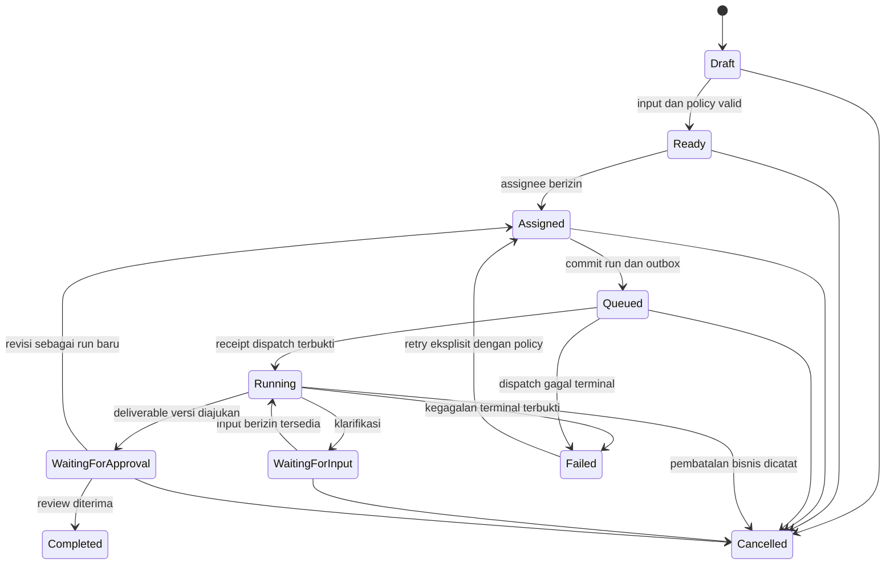
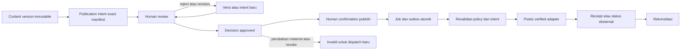

# Model domain awal

> **Usulan lintas Phase 1–6, bukan model yang sudah diimplementasikan.** Skema fisik dibuat bertahap setelah approval; [desain database](06-database-design.md) menerjemahkan invariant berikut menjadi constraint dan query.

## Bahasa bersama dan bounded modules

| Konsep | Makna/invariant | Fase |
|---|---|---|
| Organization | Batas tenant. Setiap resource bisnis mempunyai satu organisasi; ID UUID bukan mekanisme otorisasi | 1 |
| User / external identity | Principal manusia aplikasi; identity provider dipetakan dengan pasangan issuer + subject, bukan username/email saja | 1 |
| Membership, role, permission | User harus aktif di org; permission merupakan tindakan, role adalah kumpulannya. Membership bukan otomatis hak semua brand | 1 |
| Session / invitation | Sesi server-side terikat user dan org aktif; invitation terbatas waktu, sekali pakai, tidak memberi default-admin | 1 |
| Brand / user brand access | Brand milik org; grant brand eksplisit ditambah permission tindakan. Arsip menolak mutasi/dispatch baru, mempertahankan histori | 1–2 |
| Agent | Registry ID aplikasi stabil untuk salah satu profil native existing; bukan model/prompt baru. Display name/Telegram bukan kunci eksternal | 2 |
| Agent connection / capability | Mekanisme invoke, secret reference, versi kontrak dan bukti kemampuan. Configured ≠ reachable ≠ ready | 2–3 |
| Brand agent access | Izin eksplisit profil tertentu menerima konteks/kerja brand; tidak berarti boleh approve atau publish | 2–3 |
| Task | Permintaan bisnis, satu org dan brand; assignee saat ini manusia atau agen; objective, input/version refs dan deliverable schema eksplisit | 3 |
| Task run | Satu percobaan eksekusi yang berkorelasi dengan task, assignment snapshot dan external operation. Retry transport bukan otomatis run bisnis baru | 3 |
| Deliverable / version | Artefak tugas beserta versi raw output reference dan structured result tervalidasi. Output malformed tidak menjadi hasil valid diam-diam | 3 |
| Knowledge item / version | Materi brand dengan sumber, kategori, owner, versi, status draft/approved, klasifikasi dan kebijakan akses | 4 |
| Context snapshot | Manifest materi/versi terpilih yang boleh diterima run; ada provenance dan policy version, bukan dump seluruh brand | 3–4 |
| Asset / version | Metadata aset dan berkas immutable per versi; checksum, object key, MIME/signature, size dan status quarantine/clean | 4 |
| Campaign | Objective, audience, channel, owner, budget rencana/currency, periode dan KPI. Budget rencana bukan spend aktual | 4 |
| Content / version | Identitas konten dan snapshot immutable caption/body/platform metadata; exact asset version references dipertahankan | 4 |
| Publication intent | Snapshot immutable versi konten, exact media manifest, channel/platform, mode dan jadwal; fingerprint canonical | 5 |
| Approval request / decision | Human review terhadap satu intent atau deliverable/knowledge version; approved tidak berpindah ke versi baru | 5 |
| Publishing confirmation / job | Human berizin menegaskan publikasi intent yang approved; job async tidak diciptakan hanya karena agen selesai | 5 |
| Integration / channel mapping | Connection server-side dengan provider, org, secret reference dan capability; channel dipetakan eksplisit ke brand | 2–6 |
| Metric definition / observation | Definisi sumber, unit, grain, organic/paid, attribution/timezone, fakta observasi beserta provenance dan freshness | 6 |
| Audit / task event | Riwayat tindakan bisnis/keamanan dengan actor dan correlation; bukan salinan token/prompt sensitif | 1–7 |

## Invariant organisasi, brand dan actor

- Resource brand-scoped tidak boleh mereferensikan parent tenant/brand lain. Composite foreign keys membawa `org_id` dan, jika relevan, `brand_id`; validasi aplikasi saja tidak cukup.
- User boleh anggota beberapa org, tetapi satu request/session menggunakan satu org aktif yang diverifikasi. Ganti org merotasi session/context; tidak menerima tenant dari body sebagai grant.
- Permission tindakan **dan** user-brand grant wajib ada. Default roles: Owner, Administrator, Marketing Manager, Editor, Approver, Analyst, Viewer; permission matrix rinci disetujui owner. Tidak ada wildcard all-brand tersembunyi.
- Actor dibedakan human, service worker dan agent. Agent tidak mewarisi token user atau role Approver. Worker capability terikat task/run/org/brand dan selalu dibatasi use case.
- Pencabutan membership/grant/connection menghentikan side effect baru; histori tidak dihapus untuk mengakali constraint. Arsip/disable melalui status dan timestamps.
- Task dependency awal hanya di brand yang sama; workflow lintas brand ditolak sampai ada kebutuhan, grant eksplisit dan desain baru.

### Aturan pewarisan RBAC awal

Permission efektif org adalah union permission role aktif pada membership aktif. Untuk operasi brand, rumusnya **membership aktif ∧ permission tindakan ∧ grant brand aktif ∧ resource dalam scope yang sama**. Tidak ada role hierarchy/implicit superuser, brand grant tidak memberi permission baru, dan role org tidak memberi akses brand secara otomatis. Denial karena revoked/inactive mengalahkan union grant. Versi awal tidak mempunyai role berbeda per brand; bila owner membutuhkan Editor di brand A tetapi Viewer di brand B, model harus ditambah assignment role brand-scoped dan diuji sebelum kebutuhan itu dinyatakan didukung.

Contoh permission keys yang akan dimatangkan: `brand.manage`, `brand.members.manage`, `task.assign`, `knowledge.read`, `content.edit`, `approval.decide`, `publication.confirm`, `integration.manage`, `analytics.view`. Approver tidak otomatis publisher; Analyst tidak otomatis content editor; koneksi agen tidak menjadi role manusia. Matrix role→permission dan aturan owner bootstrap adalah seed terulas/idempoten Phase 1, dengan kebijakan invite/grant dibatasi permission khusus dan audit agar member manager tidak bisa menaikkan haknya sendiri tanpa kewenangan. Ini usulan policy, bukan seed yang telah dijalankan.

## Lifecycle task, run dan deliverable

Diagram menyederhanakan variasi task yang tidak perlu approval; completion tersebut tetap perlu validasi deliverable dan permission. Run menyimpan state teknis sendiri: queued, dispatching, running, waiting, succeeded, failed, cancellation_requested, cancelled, atau **unknown**. Status task cancelled tidak membuktikan agen/layanan eksternal berhenti: cancellation capability dan receipt dicatat terpisah. Response terlambat disimpan sebagai event terkarantina, tidak menghidupkan kembali task terminal.

Setiap transition memeriksa expected version/lock, actor dan allowed transition; status history append-only. Perubahan assignee membatalkan atau menandai run lama superseded sesuai policy; hasil run lama tidak menimpa hasil assignment baru. Dependency tidak boleh self/cycle, dan tidak otomatis satisfied hanya karena external submission diterima.

Request agen memakai schema version, task/run ID, operation key, objective, batas tindakan, refs input dan expected output schema. Hasil raw disimpan privat dengan redaction/retensi, hasil structured memiliki `validation_status` dan schema version; gagal validasi ditandai malformed/unvalidated. Versioning deliverable tidak bergantung pada chat history Hermes.

## Konteks, pengetahuan dan aset

Context builder memulai dari task yang tersimpan; membaca hanya materi yang diperbolehkan bagi requester, worker delegation dan agen terpilih. Approved adalah default; draft hanya opt-in berizin dengan label jelas. Snapshot mencatat exact knowledge/asset/deliverable version, sumber, klasifikasi dan policy revision. URL sementara tidak menjadi identitas sumber. Agen mendapat minimal context, bukan akses bebas database atau credential storage.

Aset mengikuti lifecycle quarantine → inspected → clean/accepted atau rejected. Implementasi scan dan batas fail-closed disetujui sebelum distribusi. Upload tidak otomatis dapat dipreview/diambil Postiz. Object key dibentuk server dengan org/brand/asset/version; object tidak ditimpa untuk versi yang sudah dirujuk. Preview hanya tipe aman di origin terpisah/sandbox atau attachment; HTML/SVG/dokumen aktif tidak dirender inline sembarangan. Delete mempertimbangkan reference versi/approval, retention dan backup.

## Approval dan publikasi

Fingerprint intent mencakup exact content version, exact ordered asset version set, checksum/crop/transform metadata yang material, provider connection/channel, format, publication mode, jadwal UTC dan timezone asal. Approval request menyimpan snapshot manifest dan hash; hash mempercepat equality, bukan menggantikan FK/immutable records. Koreksi konten/media/tujuan/jadwal membuat intent baru dan meminta approval baru. Approval lama dipertahankan sebagai histori tetapi tidak mengotorisasi intent baru; bila item yang sama diedit secara material, intent lama yang belum dispatched disupersede/revoke.

Publisher memerlukan keputusan approved yang masih aktif **dan** konfirmasi manusia berizin. Pemisahan penulis/approver/publisher dan kebutuhan step-up adalah keputusan owner; default aman: tidak menganggap agen dapat approve, tidak menganggap role Editor dapat publish. Semua perubahan social connection, spend, identitas brand dan operasi destruktif memerlukan otorisasi manusia tersendiri.

Setelah Postiz menerima jadwal, perubahan/revoke tidak bisa dijanjikan membatalkan posting di luar. Workflow mencoba cancellation/update hanya bila capability terbukti dan mendapat konfirmasi manusia yang perlu; bila tidak tersedia/hasil unknown, tampilkan risiko dan eskalasi. UI membedakan planned, submission_pending, externally_scheduled, published, failed, cancelled dan outcome_unknown. Planned draft Phase 4 tidak sama dengan externally_scheduled.

## Analitik, riset dan interpretasi

Metrik dipisah grain account/post/campaign, original source metric, definisi, unit, interval/granularity, timezone, attribution, organic/paid dan freshness. Missing/unsupported adalah availability state, bukan angka nol. CTR/ROI hanya dihitung jika numerator/denominator kompatibel dan sumber tersedia; planned campaign budget tidak dijadikan realized spend. Re-sync boleh mengoreksi observasi dengan revision/provenance, bukan menggandakan total.

Competitor observation menyimpan public reference URL, observation/source date, evidence, confidence/limitation dan versi laporan. Social listening hanya data berizin; measured fact berbeda dari interpretasi/sentimen/rekomendasi AI. Superset menampilkan hasil ingest, bukan melakukan scraping atau menciptakan akses sumber baru.

## Keputusan domain yang masih terbuka

- Apakah four-eyes approval wajib, batas self-approval, pemilik brand dan owner bootstrap serta role matrix.
- Batas material change, review expiry, allowed schedule drift, cancellation dan kondisi re-approval.
- Policy penghentian workflow ketika requester kehilangan akses versus delegasi service yang diotorisasi ulang owner.
- Jenis deliverable/schema awal dan batas informasi yang boleh diserahkan masing-masing profil Hermes.
- Retensi raw output/PII, upload size/type, kebutuhan malware scanning, legal deletion, audit retention dan metrik attribution.

Sampai diputuskan, operasi berisiko tinggi ditolak, capability belum diverifikasi disabled, dan tidak ada janji feature lengkap atau data platform yang tidak tersedia.
