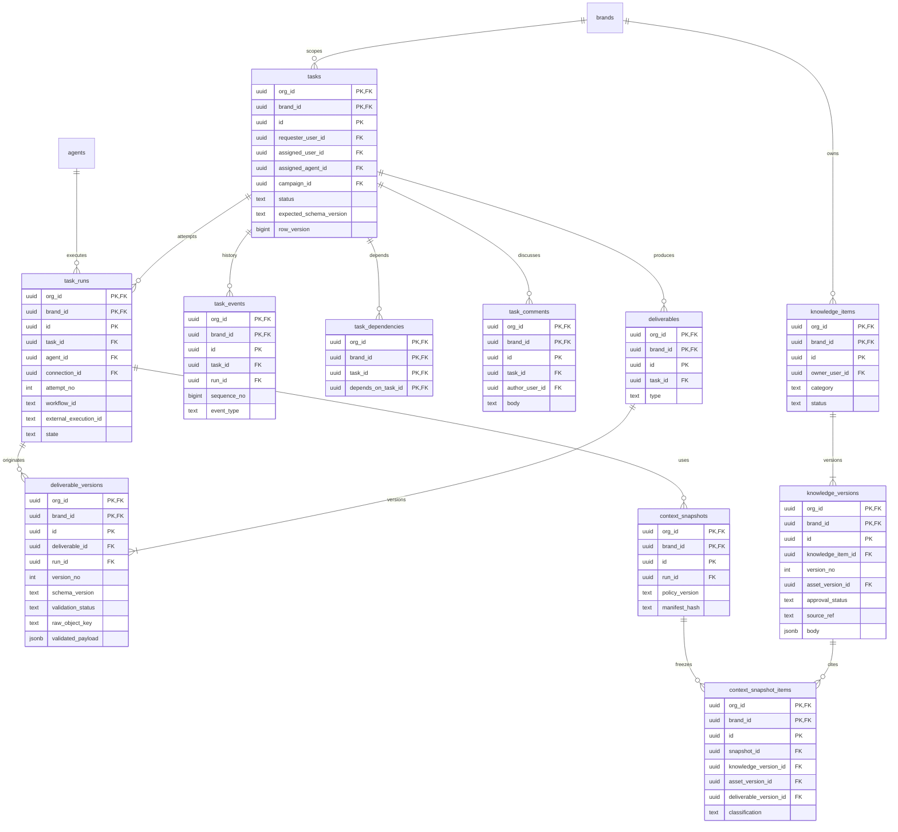
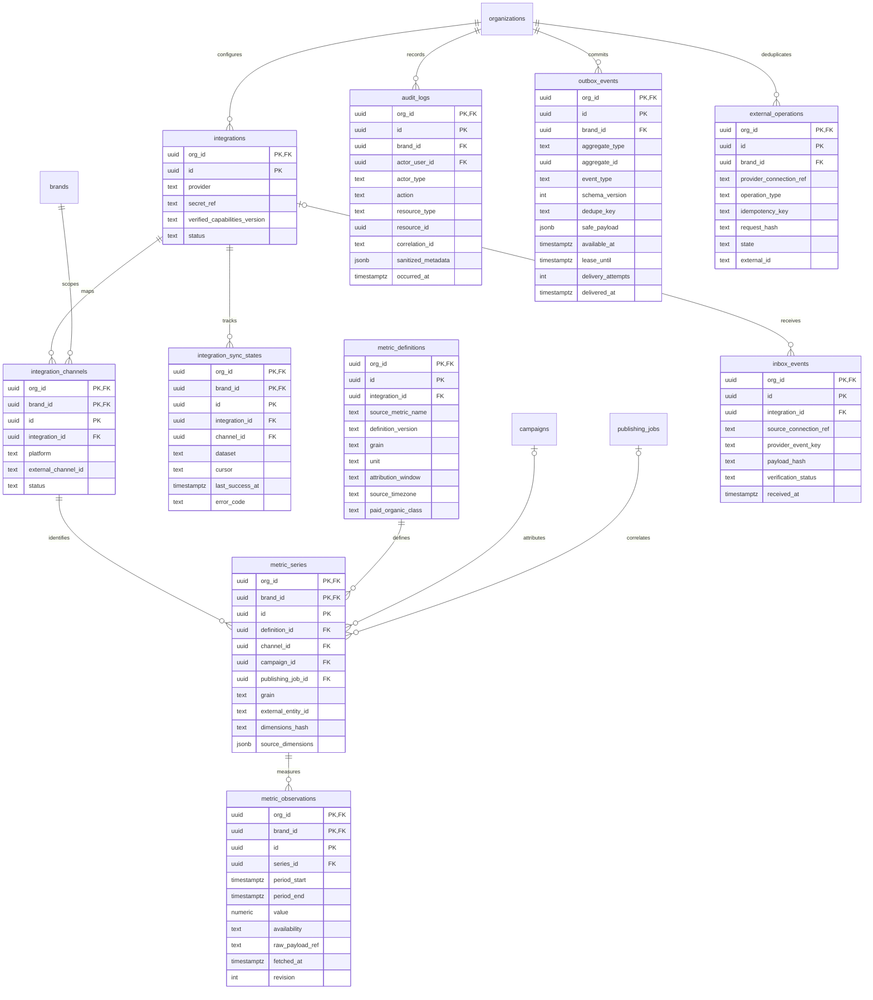

# Desain database dan ERD awal

> **Usulan Phase 0, bukan migrasi/DDL produksi.** Semua tabel adalah target bertahap dari [Phase 1](../PHASE-01-APPLICATION-FOUNDATION.md) sampai [Phase 6](../PHASE-06-ANALYTICS-AND-MARKETING-INTELLIGENCE.md). Tidak ada database yang dibuat atau diuji oleh dokumen ini. ERD memadatkan kolom agar terbaca; tabel constraint di bawah adalah bagian normatif desain.

## Konvensi dan scoping yang wajib

- PostgreSQL bisnis adalah authoritative. UUID untuk ID, `timestamptz` UTC untuk instan, `date`/timezone asal untuk semantik kalender, `numeric` + currency/unit untuk uang/metrik; tidak memakai float untuk uang.
- `O = org_id`, `B = brand_id`. Tabel org-scoped memakai PK `(O,id)`; tabel brand-scoped memakai PK `(O,B,id)`. `organizations` dan `users` adalah root dengan PK `id`; `organization_members` memakai PK `(O,user_id)`.
- `brands` memakai PK `(O,id)`; tabel brand-scoped wajib `FK (O,B) → brands(O,id)`. Semua referensi child ke resource brand-scoped membawa `(O,B,parent_id)`. UUID global sekalipun tidak membenarkan FK pada `id` saja.
- `users`, `external_identities`, katalog `permissions`, dan transient `oidc_login_requests` berada di luar tenant. Semua hubungan bisnis ke manusia menggunakan `(O,user_id) → organization_members`, bukan hanya user global. Catatan actor yang sudah tidak aktif dipertahankan lewat membership status/tombstone.
- `created_at`, `updated_at`, actor dan optimistic `row_version` untuk entity mutable; versi, event dan keputusan bersifat append-only. Status memakai CHECK/reference terkontrol dengan transition use case; jangan membuat enum sulit diubah sebelum kebutuhan jelas.
- Setiap SQL bisnis membawa org/brand yang telah diotorisasi; PK/FK menjaga integritas, bukan pengganti ACL. RLS PostgreSQL boleh menjadi defense-in-depth setelah dibuktikan aman dengan pool/transaction context, bukan asumsi otomatis. View Superset dan guest RLS tetap wajib.

## ERD 1 — identitas, RBAC, brand dan registry

```mermaid
erDiagram
    organizations ||--o{ organization_members : has
    users ||--o{ external_identities : maps
    users ||--o{ organization_members : joins
    organizations ||--o{ roles : defines
    roles ||--o{ role_permissions : grants
    permissions ||--o{ role_permissions : catalog
    organization_members ||--o{ user_roles : receives
    roles ||--o{ user_roles : assigned
    organization_members ||--o{ sessions : authenticates
    organizations ||--o{ invitations : invites
    organizations ||--o{ brands : owns
    brands ||--o| brand_profiles : describes
    organization_members ||--o{ user_brand_access : allowed
    brands ||--o{ user_brand_access : scopes
    organizations ||--o{ agents : registers
    agents ||--o{ agent_capabilities : verifies
    agents ||--o{ agent_connections : connects
    brands ||--o{ brand_agent_access : permits
    agents ||--o{ brand_agent_access : receives
    organizations {
        uuid id PK
        text name
        text status
    }
    users {
        uuid id PK
        text status
    }
    external_identities {
        uuid id PK
        uuid user_id FK
        text issuer UK
        text subject UK
    }
    organization_members {
        uuid org_id PK,FK
        uuid user_id PK,FK
        text status
        bigint authz_revision
    }
    roles {
        uuid org_id PK,FK
        uuid id PK
        text name
    }
    permissions {
        text key PK
    }
    role_permissions {
        uuid org_id PK,FK
        uuid role_id PK,FK
        text permission_key PK,FK
    }
    user_roles {
        uuid org_id PK,FK
        uuid user_id PK,FK
        uuid role_id PK,FK
    }
    sessions {
        uuid org_id PK,FK
        uuid id PK
        uuid user_id FK
        text token_hash UK
        timestamptz idle_expires_at
        timestamptz absolute_expires_at
        timestamptz revoked_at
    }
    invitations {
        uuid org_id PK,FK
        uuid id PK
        text token_hash UK
        text target_identity_binding
        timestamptz expires_at
        timestamptz used_at
    }
    brands {
        uuid org_id PK,FK
        uuid id PK
        uuid owner_user_id FK
        text status
    }
    brand_profiles {
        uuid org_id PK,FK
        uuid brand_id PK,FK
        jsonb profile
        bigint row_version
    }
    user_brand_access {
        uuid org_id PK,FK
        uuid brand_id PK,FK
        uuid user_id PK,FK
        text status
    }
    agents {
        uuid org_id PK,FK
        uuid id PK
        text display_name
        text registry_key UK
        text native_profile_ref
        text status
    }
    agent_capabilities {
        uuid org_id PK,FK
        uuid agent_id PK,FK
        text capability_key PK
        text verification_status
        text evidence_ref
        timestamptz verified_at
    }
    agent_connections {
        uuid org_id PK,FK
        uuid id PK
        uuid agent_id FK
        text mechanism
        text secret_ref
        text observed_status
        timestamptz last_observed_at
    }
    brand_agent_access {
        uuid org_id PK,FK
        uuid brand_id PK,FK
        uuid agent_id PK,FK
        text status
        text context_policy_version
    }
```

`UK` pada pasangan issuer/subject dan registry key harus dibaca bersama constraint di bawah, bukan berarti tiap kolom unik sendiri. Session menyimpan hash/HMAC token high-entropy, bukan bearer token mentah; expiry/revocation diperiksa server. Pilihan menyimpan provider token adalah minimal/tidak menyimpan bila tidak dibutuhkan; bila wajib, terpisah terenkripsi dan tidak tercampur audit. Login state/nonce/PKCE verifier yang perlu dipulihkan disimpan transient dengan proteksi sesuai sensitivitas, TTL dan single-use; state lookup hash tidak cukup untuk menggantikan nonce/verifier yang perlu dibandingkan/digunakan.

## ERD 2 — kerja, konteks dan knowledge

Manifest context memakai FK bertipe, bukan `(resource_type, resource_id)` bebas tanpa integrity. Tepat satu dari knowledge/asset/deliverable version pada setiap item; ref lain dapat ditambahkan lewat migrasi bertipe. Task input references memakai tabel `task_input_refs` dengan pola typed-FK serupa. Simpan source/version/classification dan checksum agar hasil dapat ditelusuri tanpa menyimpan dokumen rahasia di history Temporal.

## ERD 3 — kampanye, versi, approval dan publishing

```mermaid
erDiagram
    brands ||--o{ campaigns : owns
    campaigns o|--o{ tasks : groups
    campaigns o|--o{ content_items : groups
    brands ||--o{ assets : owns
    assets ||--|{ asset_versions : versions
    content_items ||--|{ content_versions : versions
    content_versions ||--o{ content_version_assets : attaches
    asset_versions ||--o{ content_version_assets : freezes
    content_versions ||--o{ publication_intents : proposes
    integration_channels ||--o{ publication_intents : targets
    publication_intents ||--o{ intent_assets : freezes
    asset_versions ||--o{ intent_assets : references
    publication_intents o|--o{ approval_requests : reviewed
    approval_requests ||--o{ approval_decisions : history
    publication_intents ||--o{ publishing_jobs : dispatches
    approval_decisions ||--o{ publishing_jobs : authorizes
    publishing_jobs ||--o{ publishing_attempts : observes
    campaigns {
        uuid org_id PK,FK
        uuid brand_id PK,FK
        uuid id PK
        uuid owner_user_id FK
        text name
        numeric planned_budget
        text currency
        timestamptz starts_at
        timestamptz ends_at
        jsonb kpi_plan
        text status
    }
    assets {
        uuid org_id PK,FK
        uuid brand_id PK,FK
        uuid id PK
        uuid campaign_id FK
        uuid owner_user_id FK
        text status
    }
    asset_versions {
        uuid org_id PK,FK
        uuid brand_id PK,FK
        uuid id PK
        uuid asset_id FK
        int version_no
        text object_key UK
        text checksum
        text detected_mime
        bigint size_bytes
        text validation_state
    }
    content_items {
        uuid org_id PK,FK
        uuid brand_id PK,FK
        uuid id PK
        uuid campaign_id FK
        uuid owner_user_id FK
        text status
        bigint row_version
    }
    content_versions {
        uuid org_id PK,FK
        uuid brand_id PK,FK
        uuid id PK
        uuid content_item_id FK
        int version_no
        uuid author_user_id FK
        jsonb body
        text change_summary
        text content_hash
    }
    content_version_assets {
        uuid org_id PK,FK
        uuid brand_id PK,FK
        uuid content_version_id PK,FK
        uuid asset_version_id PK,FK
        int ordinal
        jsonb transform_metadata
    }
    publication_intents {
        uuid org_id PK,FK
        uuid brand_id PK,FK
        uuid id PK
        uuid content_version_id FK
        uuid channel_id FK
        timestamptz schedule_at
        text source_timezone
        text publication_mode
        text manifest_hash
        text status
    }
    intent_assets {
        uuid org_id PK,FK
        uuid brand_id PK,FK
        uuid intent_id PK,FK
        uuid asset_version_id PK,FK
        int ordinal
        jsonb transform_metadata
    }
    approval_requests {
        uuid org_id PK,FK
        uuid brand_id PK,FK
        uuid id PK
        uuid publication_intent_id FK
        uuid deliverable_version_id FK
        uuid knowledge_version_id FK
        uuid assigned_approver_user_id FK
        text snapshot_hash
        timestamptz review_deadline
    }
    approval_decisions {
        uuid org_id PK,FK
        uuid brand_id PK,FK
        uuid id PK
        uuid request_id FK
        uuid approver_user_id FK
        text decision
        text comments
        timestamptz decided_at
    }
    publishing_jobs {
        uuid org_id PK,FK
        uuid brand_id PK,FK
        uuid id PK
        uuid intent_id FK
        uuid approval_decision_id FK
        uuid confirmed_by_user_id FK
        timestamptz confirmed_at
        text confirmation_hash
        text idempotency_key
        text state
        text external_post_id
    }
    publishing_attempts {
        uuid org_id PK,FK
        uuid brand_id PK,FK
        uuid id PK
        uuid job_id FK
        int attempt_no
        uuid external_operation_id FK
        text outcome
    }
```

`approval_requests` memiliki tepat satu target bertipe; publishing hanya menerima request yang menarget intent, tidak decision approval task/knowledge. Manifest intent dan child media immutable setelah diajukan review; semantic status/revocation ditempatkan pada lifecycle metadata/event terpisah atau update terbatas, bukan update snapshot. Relasi approvals multi-target dipilih agar integrity FK tetap ada; jika pemisahan tabel approval per target lebih sederhana saat implementasi, perubahan wajib menjaga invariant yang sama.

## ERD 4 — integrasi, reliability, audit dan metrik

`source_connection_ref` pada inbox/external operation di ERD ringkas harus direalisasikan sebagai FK bertipe: tepat satu `integration_id` atau `agent_connection_id`, bukan string URL bebas. Provider mapping menentukan org/brand sebelum payload diproses. `metric_series` memiliki source entity ID agar metrik post tanpa publishing job internal tetap dapat disimpan; mapping ke internal bersifat optional tetapi harus brand sama.

## Constraint compound dan uniqueness yang harus dibawa ke migrasi

| Tabel/kelompok | Constraint wajib (selain PK dan FK brand dasar) |
|---|---|
| external_identities | UNIQUE `(issuer,subject)`; FK `user_id → users(id)`. Jangan auto-link hanya karena email cocok |
| roles/user_roles/role_permissions | UNIQUE `(O,name)` roles; FK `(O,user_id) → organization_members`; FK `(O,role_id) → roles`; permission key FK katalog |
| sessions/invitations | Session FK `(O,user_id) → organization_members`; hash token unik global; idle ≤ absolute expiry. Invitation FK inviter ke membership, token hash unik, TTL, used/revoked; role/brand yang diundang ditata join table tenant-scoped |
| brands, brand_profiles, user_brand_access | Owner FK `(O,owner_user_id)`; profile FK `(O,B)`; membership grant FK `(O,user_id)`; uniqueness grant `(O,B,user_id)` |
| agents/connections/capabilities | UNIQUE `(O,registry_key)`; connection FK `(O,agent_id)`; capability PK `(O,agent_id,key)`; native profile ref adalah allowlisted identifier, bukan path user-controlled |
| brand_agent_access | FK `(O,agent_id) → agents`; PK `(O,B,agent_id)`; disabled/revoked memakai status agar histori tetap valid |
| tasks | Requester/human assignee FK membership; agent assignee FK `(O,B,assigned_agent_id) → brand_agent_access`; `num_nonnulls(assigned_user_id,assigned_agent_id) ≤ 1`, tepat satu untuk state assigned ke atas sesuai policy. Campaign FK `(O,B,campaign_id)` |
| task_dependencies | Kedua FK `(O,B,task_id)` dan `(O,B,depends_on_task_id) → tasks`; CHECK bukan diri sendiri; cycle dicegah use case dalam transaksi dengan lock yang menserialisasi perubahan graph brand |
| task_runs | FK `(O,B,task_id) → tasks`; agent FK `(O,B,agent_id) → brand_agent_access`; `(O,agent_id,connection_id) → agent_connections(O,agent_id,id)` dengan UNIQUE parent tambahan; UNIQUE `(O,B,task_id,attempt_no)`; UNIQUE external correlation pada connection jika tersedia |
| task_events/deliverable_versions | Event FK `(O,B,task_id)` dan jika ada run gunakan `(O,B,task_id,run_id)` ke UNIQUE tambahan run. Deliverable version harus run dari task yang sama: bawa `task_id` redundant + FK ke `(O,B,task_id,deliverable_id)` dan `(O,B,task_id,run_id)`; tambahkan UNIQUE parent, bukan hanya dua FK terpisah |
| context_snapshots/items/input refs | Run FK `(O,B,run_id)`; snapshot child FK `(O,B,snapshot_id)`; setiap typed ref FK `(O,B,version_id)`; CHECK tepat satu ref; per snapshot/type/ref unik |
| versions knowledge/deliverable/content/asset | Parent FK `(O,B,parent_id)`; UNIQUE `(O,B,parent_id,version_no)`; version_no > 0; author/owner FK membership; asset object key unik per bucket dan version immutable |
| content_version_assets / intent_assets | Kedua FK membawa `(O,B,...)`; UNIQUE `(O,B,parent_version_or_intent_id,ordinal)`; ordinal ≥ 0; CHECKSUM dan transform dicakup fingerprint. Manifest intent harus cocok persis dengan media konten yang ditinjau; commit oleh use case, bukan copy dari body tanpa validasi |
| approval_requests/decisions | CHECK tepat satu target bertipe; target FK `(O,B,...)`; approver FK `(O,user_id)`; decision FK `(O,B,request_id)`. Decision append-only; accept/revoke/new review memakai event/status terkontrol dengan locking untuk mencegah dua keputusan terminal aktif |
| publishing_jobs | FK `(O,B,intent_id)` dan `(O,B,approval_decision_id)`; **kedua FK saja belum membuktikan approval bagi intent yang sama**: bawa request/intent linkage pada typed publication approval binding dengan UNIQUE `(O,B,intent_id,decision_id)` lalu job FK ke tuple itu; use case memeriksa approved/nonrevoked/human. UNIQUE `(O,B,idempotency_key)`; UNIQUE active dispatch untuk intent sesuai policy; confirmed_by FK membership dan confirmed_at wajib |
| publishing_attempts/external_operations | Job FK `(O,B,job_id)`; operation ledger UNIQUE `(O,connection_kind,connection_id,operation_type,idempotency_key)` dan request hash sama; `(O,B,operation_id)` scoped UNIQUE untuk FK attempt; koneksi typed FK ke integration/agent connection. Tidak memanggil network dalam transaksi lock panjang |
| integration_channels | FK `(O,integration_id) → integrations`; UNIQUE `(O,integration_id,external_channel_id)` untuk satu mapping brand awal; provider platform+format capability diverifikasi. Ref channel brand-scoped tidak boleh menunjuk account brand lain |
| sync states/metric definitions/series | Sync FK `(O,B,channel_id)` serta constraint channel/integration konsisten memakai UNIQUE `(O,B,integration_id,id)` parent; definition FK `(O,integration_id)`; series harus definition dan channel dari integration sama (bawa integration_id dan composite FK tambahan). FK campaign/job membawa `(O,B,...)`; CHECK grain cocok internal nullable ref |
| metric observations | FK `(O,B,series_id)`; UNIQUE `(O,B,series_id,period_start,period_end)` untuk current observation, revision history terpisah; period_end > start; value nullable bila unavailable, CHECK value tidak null hanya untuk availability available; dimensions canonical hash/normalisasi deterministik |
| outbox/inbox | Outbox UNIQUE `(O,dedupe_key)`; inbox UNIQUE `(O,connection_kind,connection_id,provider_event_key)`; body hash membantu konflik, bukan mengganti event identity. Jika provider tidak memberi event ID, tentukan fingerprint kontrak yang diverifikasi, bukan asumsi |
| audit_logs | FK `(O,brand_id)` bila brand ada; actor human `(O,actor_user_id)` bila ada; worker/agent identity bertipe lain. Append-only DB privileges; resource ref informational tidak dipakai untuk otorisasi |

FK dengan nullable B untuk event/audit tingkat org memakai CHECK scope eksplisit (`org` mensyaratkan B null, `brand` mensyaratkan B not null); jangan memakai null sebagai wildcard brand. Foreign key bersifat `RESTRICT` untuk data bisnis/versi/histori; cascade hanya join/transient yang betul-betul dimiliki parent setelah kebijakan retensi ditinjau. Privilege aplikasi tidak boleh update/delete versi immutable atau audit sembarangan; integritas snapshot dapat diperkuat trigger/privilege terpisah. Fingerprint canonical dan cross-row manifest/approval invariants tetap memerlukan transaksi/use case atau trigger teruji; FK tidak menyelesaikan semua aturan.

## Tabel pendukung yang belum digambar penuh

- `oidc_login_requests`: state hash, nonce/verifier protected, redirect allowlist key, expiry, used_at; tidak log token. `invitation_roles` dan `invitation_brand_access` tenant scoped untuk hak yang benar-benar disetujui.
- `task_input_refs`, `context_snapshot_items`, `task_comments`, `task_events`: typed refs dan status history, tidak polymorphic unchecked untuk akses data.
- `approval_state_events`/`publication_approval_bindings`: typed binding intent–decision serta revoke/supersede; tambahkan CHECK/trigger/use case sehingga binding hanya dibuat dari request intent yang sama. Ini bukan menyalin approval ke versi baru.
- `agent_connection_observations`, `dispatch_attempts`, `external_operation_attempts`: evidence status, redacted errors, timeout/receipt, lease/token untuk fencing bila diperlukan.
- `upload_sessions`: quarantine object key, expiry, expected checksum/size dan finalization status. `metric_observation_revisions`, `metric_sync_runs`: koreksi/provenance dan sync health.
- `competitor_profiles`, `competitor_observations`, `report_versions`: FK `(O,B,...)`, source URL/date/evidence/confidence, observed fact terpisah dari AI interpretation, exact report version.
- `analytics_dashboard_access`: dashboard allowlist dan required permission, server-approved org/brand context. Tidak menyimpan Superset admin credential atau arbitrary RLS SQL dari browser.
- `authentication_events`: event keamanan pre-auth dengan ID, outcome/reason code aman, timestamp/correlation dan subject pseudonym bila layak; org/user opsional hanya setelah resolve terverifikasi. Ini event global terbatas untuk login gagal yang belum mempunyai tenant, bukan alasan memakai org null pada `audit_logs` bisnis atau mencatat code/token/raw claims. Akses dan retensinya lebih ketat; event tenant-known dicatat pula sesuai policy audit tanpa duplikasi data rahasia.

## Transaksi, outbox dan idempotensi

1. Use case mengotorisasi scope, lock entity/expected version, mengubah state, menulis audit/event dan outbox pada transaksi PostgreSQL yang sama. Rollback berarti tidak ada dispatch.
2. Relay claim batch lewat `FOR UPDATE SKIP LOCKED` + lease singkat, commit claim, panggil Temporal di luar transaksi, lalu ack `delivered_at`. Crash sebelum ack berarti event bisa terkirim lagi.
3. Workflow ID stabil berdasarkan tipe operasi + org + aggregate/run/job ID. Pengulangan outbox tidak membuat run/job bisnis baru; conflict Temporal direkonsiliasi dengan mapping. Signal memakai event ID unik; consumer business transition idempoten.
4. Activity reserve operation ledger dalam transaksi; duplicate key dengan request hash berbeda = conflict. Network call dilakukan sesudah commit reservation. Crash/timeout setelah submit mengubah hasil menjadi unknown sampai ada bukti; operasi yang tidak mendukung external idempotency tidak boleh otomatis dikirim ulang.
5. Callback autentikasi/inbox dedupe → resolve correlation server-side → lock run/job → append outcome/event + outbox → commit. Out-of-order tidak menurunkan state terminal yang sudah final; polling menyatu lewat jalur use case yang sama.
6. Perubahan approval/confirmation dan dispatch saling memerlukan lock/revision check sebelum submission. Race setelah layanan eksternal menerima tidak bisa dihapus oleh rollback lokal; catat uncertain/cancel-needed dan lakukan rekonsiliasi, jangan mengklaim exactly-once.

## Indeks dan query awal

- PK/FK scoped; indeks child FK yang sering dijoin tidak otomatis dijamin oleh FK, harus dibuat sesuai query plan.
- `tasks (O,B,status,updated_at,id)`, dependency target, `task_runs (O,B,task_id,attempt_no)`, events sequence; keyset pagination stabil, bukan unbounded offset/list.
- `content_items (O,B,status,updated_at,id)`, campaign date/status, publication intent schedule/status, job pending/unknown partial indexes.
- Session token hash unique dan expiry/revoked lookup; membership/grant status serta authz_revision untuk invalidasi cache. Sesi PostgreSQL adalah master, bukan Redis.
- Outbox partial `(available_at,id)` untuk undelivered dan lease expired, inbox dedupe index, ledger status/reconcile schedule.
- Metric observations `(O,B,series_id,period_start)` dan freshness index. Hindari hash nullable dimensions yang menghasilkan duplicate semantik; normalisasi menjadi `metric_series` wajib.
- Search knowledge awal PostgreSQL full-text/index dengan scope org/brand dan approved/classification filter dalam query. GIN JSONB atau partitioning hanya setelah kebutuhan dan EXPLAIN dibuktikan.

## Peran DB, lifecycle dan pemulihan

Usulan role: migrator memiliki DDL, API/worker mendapat operasi minimal, audit writer append-only, Superset analytics read-only ke curated view tanpa PII/secret. Temporal/Authentik/Postiz/Superset memakai database/role vendor terpisah; jangan memberi worker akses tabel internal vendor. Credential hanya secret reference di business table, ciphertext token opsional di storage terbatas dengan key rotation terpisah.

Backup PostgreSQL dan MinIO harus konsisten dengan metadata/ref; simpan checksum dan manifest backup. Restore order: DB/keys/config → object store → aplikasi → worker dengan dispatch ditahan → reconcile provider eksternal sebelum resume. External post tidak dibatalkan oleh restore DB. Retensi, legal deletion, RPO/RTO dan offsite encrypted backup belum disepakati; restore drill adalah gate Phase 7. Migrasi expand/contract dan compatibility API-worker penting; rollback binary bukan alasan menjalankan destructive down migration otomatis.

## Uji desain yang wajib sebelum menerima migrasi

- FK menolak child org A yang menunjuk brand/task/asset/content/channel org B; juga menolak beda brand dalam org sama.
- Query detail/list/search/export/presigned URL/token BI tidak mengembalikan brand yang tak diberi grant; worker dengan grant dicabut gagal aman.
- Approval dari intent lain, exact media mismatch, self-approval yang dilarang policy dan stale content ditolak; dua concurrent confirmations tidak membuat duplicate dispatch.
- Concurrent task dependencies tidak membentuk cycle; event/run dari task lain ditolak; versi/material snapshot tidak dapat ditimpa.
- Crash relay sebelum/selesai ack, duplicate callback, malformed deliverable, worker restart dan Postiz unknown outcome direkonsiliasi tanpa blind retry.
- Metric re-sync, source correction, missing value dan grain/timezone berbeda tidak menggandakan/merusak hasil agregasi; BI cross-brand tests negatif.

Daftar ini adalah rencana acceptance. Belum ada migration, SQL execution, restore, benchmark atau live integration test yang dijalankan pada baseline Phase 0.
