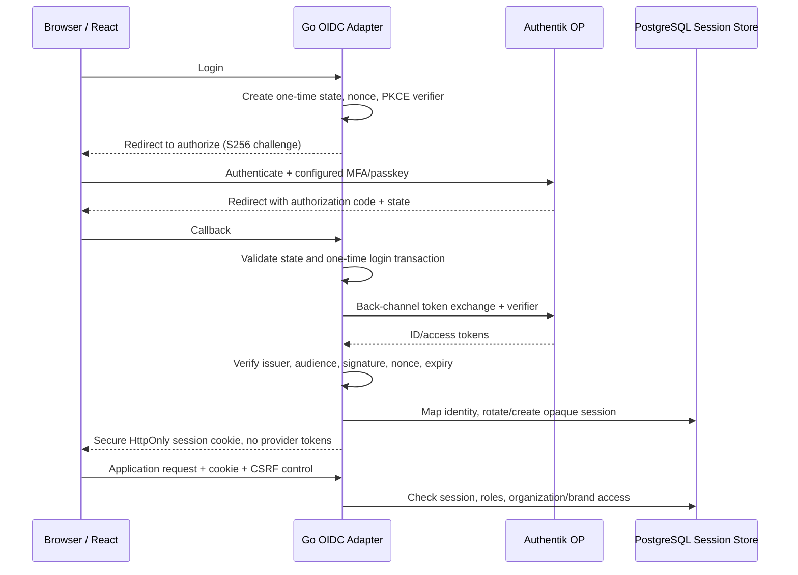

# 08 — Discovery Authentication dan Security

**Proyek:** MenerjangBadai — AI Marketing Office 
**Tahap:** Phase 0; rancangan untuk Phase 1 dan kontrol Phase 3/5 
**Tanggal telaah:** 6 November 2026, berdasarkan sumber resmi yang diambil 5 November 2026 UTC 
**Gate:** **FEASIBLE berdasarkan published docs; deployment dan login end-to-end BELUM TERVERIFIKASI.**

## 1. Status dan batas discovery

Dokumen ini mengikuti `PHASE-00-DISCOVERY-AND-ARCHITECTURE.md`, `PHASE-01-APPLICATION-FOUNDATION.md`, `PHASE-03-HERMES-INTEGRATION-AND-WORKFLOWS.md`, dan `PHASE-05-APPROVAL-AND-POSTIZ-PUBLISHING.md`. Ini keputusan/rencana security, bukan klaim aplikasi authentication telah dibangun.

**Belum ditemukan deployed Authentik maupun Postiz dalam evidence yang tersedia untuk tugas ini.** Tidak ada domain, issuer, client ID, versi/image digest atau konfigurasi provider aktual yang telah diverifikasi. Ini bukan bukti bahwa layanan tersebut tidak mungkin ada di host lain: inventory infrastruktur penuh berada di luar inspeksi terbatas ini. Tidak ada pemasangan layanan, perubahan proxy/firewall, pembacaan `.env`/secret backup/session, login, token exchange atau panggilan API bercredential.

Bukti dibedakan menjadi:

- **Published docs:** sumber resmi Authentik yang dibaca saat discovery; fitur dokumentasi tidak otomatis berlaku pada versi deployment nantinya.
- **Local report/static source:** hanya untuk Hermes, lihat [09-hermes-integration.md](09-hermes-integration.md); bukan validasi Authentik.
- **Proposed:** desain MenerjangBadai yang masih perlu approval dan implementasi/test Phase 1.
- **Pending:** bukti deployment/security behavior yang belum diperoleh.

## 2. Keputusan arsitektur human authentication (proposed)

Gunakan **Go backend sebagai OIDC Relying Party / Backend-for-Frontend**, Authentik sebagai OpenID Provider, dan React + TypeScript sebagai session client. Authentik mendukung OAuth2/OIDC, Authorization Code dan PKCE menurut dokumentasi resmi.[2]

Phase 1 mensyaratkan Authorization Code Flow dengan **PKCE S256**, state dan nonce; jangan menggantinya dengan Implicit Flow, login langsung ke database, atau token yang disimpan React. Contoh resmi Authentik juga menggunakan `code_challenge_method=S256`; itu bukti published support, bukan hasil uji server kita. Fitur DPoP/`bound_key` pada halaman contoh tersebut **tidak** menjadi requirement rancangan ini.[22]

Diagram adalah rencana, bukan deployed trace. OIDC/session implementations ditempatkan pada outbound adapters; inbound HTTP handler tipis, domain bebas OIDC/HTTP/SQL dependency. Application use cases tetap memeriksa authorization.

## 3. Issuer, discovery, endpoint dan client configuration

### Published Authentik endpoint contract

Ganti `https://sso.example.invalid` dengan origin HTTPS yang disetujui setelah deployment. Seluruh nilai berikut **template**, bukan host yang ditemukan.

| Item | Template menurut published docs |
|---|---|
| Default per-provider issuer | `https://sso.example.invalid/application/o/<application_slug>/` |
| Discovery | `https://sso.example.invalid/application/o/<application_slug>/.well-known/openid-configuration` |
| Authorization | `/application/o/authorize/` |
| Token | `/application/o/token/` |
| UserInfo | `/application/o/userinfo/` |
| JWKS | `/application/o/<application_slug>/jwks/` |
| Token revocation | `/application/o/revoke/` |
| End session | `/application/o/<application_slug>/end-session/` |

Endpoint dan default issuer mode didokumentasikan resmi; gunakan discovery document aktual untuk konfigurasi adapter, bukan menganggap template telah aktif.[2]

Authentik juga memiliki global issuer mode. Pada mode itu nilai issuer adalah root origin, tetapi discovery tetap berada di application-slug path. Rancangan memilih **per-provider issuer** agar tidak salah menurunkan discovery URL dari root issuer; URL discovery dan `issuer` yang diharapkan harus diverifikasi exact, termasuk trailing slash.[2]

### Checklist konfigurasi provider/client (belum dilakukan)

1. Owner menentukan domain TLS, slug aplikasi yang stabil, environment separation, versi Authentik yang dipin dan security-update policy. Buat Application + OAuth2/OIDC Provider melalui admin interface sesuai prosedur resmi.[7]
2. Buat **confidential client** untuk Go backend; simpan client secret hanya pada secret store server. Gunakan Authorization Code dengan PKCE S256 juga pada confidential client. Pilih token endpoint authentication method yang benar-benar diiklankan/dikonfigurasi, bukan menebaknya.[2][22]
3. Daftarkan redirect URI exact per environment. Contoh callback aplikasi yang diusulkan: `https://office.example.invalid/auth/oidc/callback`; route ini **bukan route yang telah diimplementasikan**. Jangan kosongkan daftar: Authentik dapat menyimpan URI dari first use bila field kosong; regex juga tersedia tetapi tidak dipilih untuk deployment ini.[2]
4. Request scopes eksplisit minimum `openid profile email`. Jangan meminta admin API scope, semua configured scopes, atau `offline_access` tanpa kebutuhan. Authentik mensyaratkan request **dan** scope mapping `offline_access` untuk refresh token.[2][7]
5. Pilih asymmetric Signing Key dan validasi melalui JWKS dengan algorithm allowlist. Dokumentasi menyebut HS256 dengan client secret jika Signing Key tidak dipilih, dan public JWKS signing key tidak tersedia dalam kondisi itu; jangan mengasumsikan semua provider otomatis memakai RS256.[2]
6. Bind access policy dan authentication/authorization/invalidation flow; putuskan MFA, recovery, inactivity, deprovisioning dan step-up policy. Jangan menganggap provider OIDC saja otomatis mewajibkan MFA.
7. Tetapkan logout method/URI hanya setelah kemampuan aplikasi dan versi provider diuji. Front/back-channel logout pada dokumentasi diberi label **2025.8.0+ Preview** saat ditelaah; deployment belum ada untuk memastikan kompatibilitas.[8]

### Login callback validation yang wajib diimplementasikan

Berikut requirement aplikasi, belum hasil tes:

- State acak, one-time, terikat browser login transaction dan berumur pendek; reject missing/mismatch/replayed state dan unsolicited callback.
- PKCE verifier disimpan server-side, hanya satu kali dipakai; challenge S256. Tolak flow tanpa verifier yang cocok, expired/reused code, serta token response gagal.
- Validasi ID token signature memakai trusted JWKS dari issuer allowlist; algorithm allowlist, `iss`, `aud`/`azp` bila relevan, expiry, issued time, nonce, dan batas clock skew. Jangan mengambil issuer/JWKS URL dari token tidak tepercaya.
- ID token mengautentikasi human, bukan bearer untuk mengakses A2A/Postiz. Access token tidak dianggap session cookie atau source of truth role aplikasi.
- Redirect sesudah login memakai allowlist local path untuk mencegah open redirect. Callback URL, error response dan proxy logs harus meredaksi code/token/query sensitif.

## 4. Claims dan user mapping

Dokumentasi menjelaskan scope `profile` untuk profil dasar/username/nama/group membership dan `email` untuk email. Mulai 2025.10, `email_verified` default **False**, berbeda dari perilaku versi lama; jangan mengasumsikan email sudah diverifikasi.[2]

Mapping proposed:

| Field | Kebijakan aplikasi |
|---|---|
| `iss` + `sub` | Unique external identity key; gunakan untuk upsert/link user, bukan email/username yang dapat berubah |
| `name`, `preferred_username` | Atribut tampilan bila tersedia; bukan permission |
| `email`, `email_verified` | Kontak/undangan; jangan otomatis account-link/menambah organisasi berdasarkan email saja |
| `groups` / custom entitlements | Optional mapping terkontrol dan diuji; bukan akses superadmin otomatis |
| `sid` | Simpan jika tersedia untuk scoped back-channel logout; bukan internal session token |
| `auth_time`, `acr`, `amr` | Step-up/freshness hanya jika benar-benar diterbitkan dan dimaknai sesuai kebijakan provider yang diuji |

`iss`, `sub`, signature, audience dan nonce harus tervalidasi sebelum mapping. Unknown user/group harus fail closed atau mengikuti invitation/onboarding flow yang disetujui. RBAC aplikasi, organization membership, serta brand access tetap authoritative di PostgreSQL.

Role awal dari Phase 1: Owner, Administrator, Marketing Manager, Editor, Approver, Analyst, Viewer. Matriks permissions rinci masih perlu approval; role tidak boleh hanya diterapkan melalui visibility frontend. Pisahkan create/edit, approve, publish, account connection, credential administration dan audit access; cek organization/brand pada setiap use case, download asset, task result, retry/cancel dan publication.

## 5. MFA dan passkey feasibility

Authentik menerbitkan WebAuthn/FIDO2/passkey enrollment yang mendukung security key, platform authenticator dan passkey; enforcement saat login memerlukan Authenticator Validation stage, bukan sekadar enrollment stage.[10]

Authenticator Validation dapat dikonfigurasi `Skip`, `Deny`, atau `Configure` untuk pengguna tanpa authenticator yang cocok. `Skip` memungkinkan login tanpa MFA; flow yang membutuhkan MFA tidak boleh menggunakannya tanpa kebijakan eksplisit.[17]

Rekomendasi proposed:

- MFA untuk semua human; phishing-resistant WebAuthn/passkey untuk Owner/Administrator/Approver dan pengelola akun publikasi. Recovery/break-glass harus dibatasi, diaudit, dan diuji.
- Sensitive operations (publish, account changes, role/permission changes, spend, destructive operations) memerlukan recent authentication/step-up sesuai risiko dan persetujuan manusia.
- Jangan mengklaim satu `prompt=login`, role claim atau login sukses membuktikan faktor kedua. Uji flow nyata, freshness dan recovery; browser/device compatibility, origin/RP-ID dan TLS masih pending.

## 6. Application session dan logout

Requirement Phase 1 berikut **belum diimplementasikan/diverifikasi**:

- Cookie opaque high-entropy, `HttpOnly`, `Secure` di production, `SameSite=Lax` atau lebih ketat bila kompatibel; batasi host/path dan pertimbangkan prefix `__Host-` pada HTTPS yang sesuai.
- Simpan session server-side dengan identifier hash, user/organization, created/last-used/expiry, privilege version, revocation dan correlation ke provider session bila ada. Jangan simpan long-lived token di localStorage/sessionStorage atau URL.
- Rotate session setelah login dan privilege changes; idle/absolute expiration, logout lokal, revocation dan reauthentication wajib. Nilai timeout operasional masih perlu diputuskan, bukan default provider yang diasumsikan aman.
- CSRF token plus Origin validation pada state-changing application requests. OIDC state melindungi login transaction, bukan pengganti CSRF seluruh aplikasi. Logout aplikasi harus menghapus/revoke session server-side meskipun provider tidak tersedia.

Published docs membedakan RP-initiated end-session dari full SLO: secara default hanya session aplikasi terkait yang diakhiri sementara session Authentik dapat tetap aktif. Front-channel memerlukan browser; back-channel mendukung administrative termination dan mengirim signed JWT logout token. Dukungan RP harus eksplisit dan diuji.[8]

Back-channel endpoint aplikasi yang kelak dibuat harus memvalidasi signature/JWKS, exact issuer, audience client ID, `iat`, `jti` replay window, event claim serta `sid`/`sub`; revoke session yang cocok secara idempotent, bukan menonaktifkan user lintas organisasi tanpa scope. Uji session deletion/deactivation di provider dan penolakan session lokal setelahnya. Jangan menjanjikan global logout tanpa konfigurasi dan uji tersebut. Token revocation provider, provider session, dan application session adalah objek berbeda; satu operasi tidak membuktikan semuanya tercabut.

## 7. Reverse proxy, TLS dan secret boundary

Authentik memerlukan Host/`X-Forwarded-Host`, `X-Forwarded-Proto`, `X-Forwarded-For` yang benar; proxy harus overwrite spoofed client headers. WebSocket/HTTP1.1+ dibutuhkan untuk komunikasi outpost. Hanya direct proxy source CIDRs yang dipercaya; deployment harus memverifikasi jaringan aktual.[9]

Discovery/JWKS/token endpoints harus bisa dijangkau Go backend tanpa interactive WAF/browser challenge; jangan mematikan security deployment secara menyeluruh untuk melewati 403. JWKS berisi public keys, bukan private signing keys.[2]

Rancangan keamanan lain:

- TLS production, narrow trusted proxy configuration, tidak ada blind trust terhadap forwarded headers. Jangan cache auth responses, API atau callback; static asset caching dipisahkan.[9]
- Human identity OIDC, A2A service caller credential dan Postiz API/OAuth token tidak saling ditukar. Browser tidak boleh mengetahui A2A/Postiz/client secrets.
- Secret store/server injection, least privilege, rotation/revocation procedure dan log redaction; Git hanya placeholder. Jangan memasukkan `.env`, cookie, refresh token, signed media URL, authorization header atau raw callback query ke audit.
- Egress allowlist untuk issuer, Hermes dan Postiz; jangan fetch arbitrary discovery/JWKS/media URL dari input pengguna. Jangan memperluas listener Hermes untuk memudahkan container networking tanpa approval.
- Security audit: login success/failure bila tersedia, logout, session revocation, invitation, role/permission/admin configuration changes, task dispatch/retry/cancel, approval/publish. Rekam actor/object/organization/brand/decision/time/request ID, bukan credential atau seluruh prompt secara default.

Contoh risiko version pin: advisory resmi CVE-2026-40166 mendokumentasikan confidential-client secret exposure lewat OAuth access-token API dan perbaikannya pada 2025.12.5/2026.2.3. Ini bukan penilaian versi lokal—tidak ada versi deployment yang diperiksa. Pemilihan release harus meninjau seluruh advisory terbaru, bukan menganggap dua versi perbaikan historis tersebut sebagai rekomendasi terbaru.[23]

## 8. Approval dan external side effects

Phase 5 mensyaratkan explicit human authorization. Completion Hermes, hasil AI, pesan peer, OIDC group atau status Postiz **bukan approval publikasi**.

Backend harus mengikat approval ke exact content version, asset versions/hashes, organization/brand, intended channel/platform, publication intent/schedule, approver dan timestamp. Material edit membatalkan approval atau memerlukan approval baru. Tepat sebelum dispatch external job, cek session/permission, approval validity dan destination mapping kembali dalam batas transaksi yang sesuai. Jangan meneruskan secret ke agent atau memberi tool publishing hanya karena agent diberi tugas menyusun draft.

PostgreSQL menyimpan authoritative approval/publication intent dan audit; Temporal mengeksekusi workflow, Postiz menjadi publishing engine. Unknown external outcome harus direkonsiliasi, bukan blind retry. Lihat [10-postiz-integration.md](10-postiz-integration.md).

## 9. Acceptance evidence yang masih wajib

| Gate | Status | Bukti minimum sebelum dinyatakan passed |
|---|---|---|
| Deployed Authentik ditemukan | **Pending** | Host/environment, release/image digest, owner, security advisories dan TLS tervalidasi |
| OIDC metadata | Published feasibility saja | Exact discovery `issuer`, endpoints, JWKS, algorithms, grant/auth methods, S256 support pada instance |
| Client/redirect/claims | **Pending** | Confidential client; exact URI allowlist; non-secret config record; expected `sub`/claims dari login yang disetujui |
| Login positive/negative | **Pending** | Authorized human login; reject wrong state/nonce/verifier/issuer/audience/signature/expiry/replayed code |
| MFA/passkey | **Pending** | Enrollment + required validation, no-MFA refusal, recovery dan step-up behavior |
| Session/CSRF | **Pending** | Cookie attributes, rotation, idle/absolute expiry, revocation, cross-origin state-changing rejection |
| Logout | **Pending** | Local logout; provider end-session semantics; signed/replayed/invalid back-channel token dan admin deactivation |
| RBAC/organization/brand isolation | **Pending** | Backend tests untuk semua role, cross-brand/organization access denial, inactive user refusal |
| Secret/log/proxy controls | **Pending** | Negative leak checks, spoofed header tests, server-to-server discovery/JWKS tanpa challenge |
| Postiz/Hermes machine boundary | **Pending** | Service identity, scope, network path dan approved credential provisioning; lihat dokumen integrasi |

Kesimpulan: OIDC Authentik **layak secara dokumentasi**, tetapi tidak ada deployed Authentik/Postiz yang telah ditemukan/divalidasi pada evidence ini. Discovery security belum menutup gate Phase 0, dan acceptance Phase 1 tidak boleh dicentang sebelum pengujian nyata yang disetujui. Infrastruktur, domain, secret provisioning dan perubahan runtime memerlukan approval terpisah.

## Sources

[2] https://docs.goauthentik.io/add-secure-apps/providers/oauth2
[7] https://docs.goauthentik.io/add-secure-apps/providers/oauth2/create-oauth2-provider
[8] https://docs.goauthentik.io/add-secure-apps/providers/oauth2/frontchannel_and_backchannel_logout
[9] https://docs.goauthentik.io/install-config/reverse-proxy
[10] https://docs.goauthentik.io/add-secure-apps/flows-stages/stages/authenticator_webauthn
[17] https://docs.goauthentik.io/add-secure-apps/flows-stages/stages/authenticator_validate
[22] https://docs.goauthentik.io/add-secure-apps/providers/oauth2/key-binding
[23] https://docs.goauthentik.io/security/cves/CVE-2026-40166
