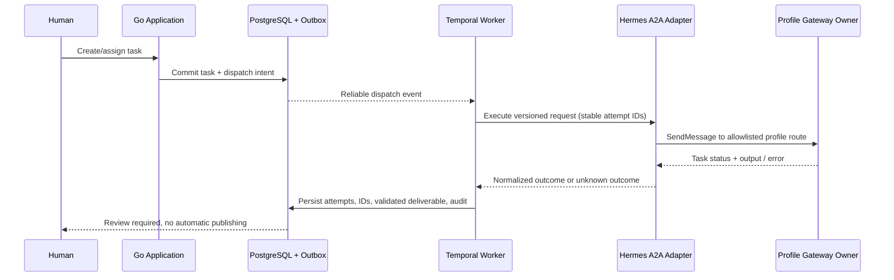

# 09 — Discovery Integrasi Hermes Agent

**Proyek:** MenerjangBadai — AI Marketing Office<br>
**Tahap:** Phase 0; rancangan integrasi untuk Phase 3, bukan implementasi<br>
**Tanggal telaah:** 6 November 2026 CST (UTC+08:00; pengambilan sumber pada 5 November 2026 UTC)<br>
**Gate:** **BELUM LULUS — live security validation dan kontrak adapter masih menunggu.**

## 1. Ruang lingkup dan tingkat bukti

Dokumen ini mengikuti `PHASE-00-DISCOVERY-AND-ARCHITECTURE.md`, `PHASE-01-APPLICATION-FOUNDATION.md`, `PHASE-03-HERMES-INTEGRATION-AND-WORKFLOWS.md`, dan `PHASE-05-APPROVAL-AND-POSTIZ-PUBLISHING.md`. Phase 0 harus ditinjau dan disetujui sebelum implementasi besar. Tidak ada perubahan persona, konfigurasi, runtime, atau routing Hermes; tidak ada pengiriman pesan, model call, restart, atau probe A2A dalam pekerjaan ini.

Label bukti yang digunakan:

- **Published docs:** perilaku yang diterbitkan di dokumentasi resmi saat dibaca; bukan bukti versi terpasang atau deployment.
- **Inspected source:** kode lokal dibaca secara statis; bukan bukti kode sudah dimuat proses gateway.
- **Historical report:** hasil yang dilaporkan artefak lokal terdahulu; tes tidak dijalankan ulang di discovery ini.
- **Proposed / pending:** keputusan desain atau pengujian yang masih harus disetujui/dilakukan.

### Bukti lokal yang diizinkan

| ID | Artefak | Batas bukti |
|---|---|---|
| H-L1 | `/home/ubuntu/ai-marketing-office/a2a/native-fix/STATUS.md` | Laporan patch lokal dan 203 targeted tests; secara eksplisit bukan safe deployment |
| H-L2 | `/home/ubuntu/ai-marketing-office/a2a/native-fix/namespace-review-result.json` | Review terbatas, `passed=true`, `gateway_deployed=false`; reviewer tidak menjalankan tes/live calls |
| H-L3 | `/home/ubuntu/ai-marketing-office/telegram/validation-report.json` | Snapshot 2026-11-05T06:50:57Z: 6/6 connected; Telegram end-to-end dan A2A live security masih belum diverifikasi |
| H-L4 | `/home/ubuntu/ai-marketing-office/a2a/plan.json` | Rencana route/profile/tenant dan referensi secret; bukan konfigurasi efektif atau health check |
| H-L5 | `/home/ubuntu/.hermes/hermes-agent/plugins/platforms/a2a/adapter.py` | Inspeksi bagian routing, forwarding, timeout, task ownership, cancellation, persistence |
| H-L6 | `/home/ubuntu/.hermes/hermes-agent/plugins/platforms/a2a/protocol.py` | Inspeksi framing v1.0, in-memory TaskStore, identitas dan namespace conversation |
| H-L7 | `/home/ubuntu/.hermes/hermes-agent/plugins/platforms/a2a/tools.py` | Inspeksi client request, bearer header, tenant dan history boundary |

Tidak membaca `.env`, backup secret, deployment receipt, database/session/transcript, atau konfigurasi Hermes lain. Path di atas adalah provenance operator, bukan file yang harus disalin ke Git atau dibaca oleh aplikasi.

## 2. Enam identitas yang harus dipertahankan

Nama/role dan route bersumber dari H-L4; profile, `agent_id`, username, serta preservation flags diperkuat H-L3. `agent_id` di bawah adalah ID Office/routing yang tercatat, **bukan klaim UUID global Hermes**. Display name Telegram aktual tidak diperiksa ulang lewat Bot API.

| Display name / role | Hermes profile | Office agent ID / tenant | Telegram username | Route rencana |
|---|---|---|---|---|
| Claudia — Marketing Director | `marketingdirector` | `claudia` | `@MB_claudia_bot` | `http://127.0.0.1:9900/claudia/` |
| Jordan — Marketing Strategist | `marketingstrategist` | `jordan` | `@MB_jordan_bot` | `http://127.0.0.1:9900/jordan/` |
| Kobe — Creative Lead | `creativelead` | `kobe` | `@MB_kobe_bot` | `http://127.0.0.1:9900/kobe/` |
| Curry — Market Researcher | `marketresearcher` | `curry` | `@MB_curry_bot` | `http://127.0.0.1:9900/curry/` |
| Sabrina — Social Media Copywriter | `socialmediacopywriter` | `sabrina` | `@MB_sabrina_bot` | `http://127.0.0.1:9900/sabrina/` |
| Kyrie — Creative Designer | `creativedesigner` | `kyrie` | `@MB_kyrie_bot` | `http://127.0.0.1:9900/kyrie/` |

H-L3 melaporkan `soul_preserved=true` dan `permissions_preserved=true` pada keenam profile serta default files unchanged. Itu laporan historis, bukan pembacaan ulang SOUL/config. Rencana memiliki lima non-self peers per profile; 30 directed edges yang dikonfigurasi tidak sama dengan 30 edges yang diuji. Penugasan langsung ke setiap specialist tetap wajib; Claudia bukan gateway bisnis yang harus dilewati semua tugas.

## 3. Mekanisme programmatic yang ditemukan

Dokumentasi resmi menjelaskan native A2A v1.0 melalui HTTP, dengan inbound gateway dan outbound `a2a` toolset; ini bukan API Telegram dan bukan alasan membuat wrapper CLI baru. A2A ditujukan untuk batas process/machine/framework; dokumentasi menyarankan delegation/kanban untuk kebutuhan multi-agent lokal yang sesuai.[1]

| Kemampuan | Published docs | Installed/local evidence | Keputusan Phase 0 |
|---|---|---|---|
| Discovery | `GET /.well-known/agent-card.json`; alias legacy `agent.json` | H-L5 mendukung served profile routes dan cards | Gunakan card route tujuan; card 200 tidak membuktikan execution/isolation |
| Submit | JSON-RPC 2.0 `SendMessage`; alias legacy `message/send` | H-L5/H-L7 memiliki jalur dispatch | Kandidat adapter utama; belum diizinkan traffic aplikasi |
| Correlation/output | `contextId`, task result; percakapan multi-turn | H-L6: task `id`, `contextId`, `status`, `artifacts`; canonical send response membungkus `task` | Simpan external IDs serta raw response teredaksi; validasi output terstruktur terpisah |
| Status | `GetTask`, `ListTasks` | H-L5 owner/route/tenant filter; H-L6 TaskStore in-memory | Polling perlu dibuktikan pada deployment; bukan durable business record |
| SSE | `SendStreamingMessage`, `SubscribeToTask` | H-L5 mengiklankan streaming berdasarkan route `local`; forwarded route tidak boleh diasumsikan setara | Optional, disabled sampai diuji per route |
| Callback | Push-notification config CRUD; webhook HMAC-SHA256 | Ada handler pada H-L5 | Signature contract, reachability, replay dan delivery belum diuji |
| Cancel | `CancelTask` | H-L5 mengubah task state/resolves pending; tidak terlihat penghentian owner/model di handler ini | Best-effort protocol cancellation, bukan jaminan work/side effects berhenti |
| Timeout/retry | Reply timeout, anti-loop dan per-peer controls | H-L5/H-L6 memiliki scoped retry identities dan owner admission compatibility | Timeout bisa berarti outcome unknown; jangan otomatis dispatch ulang |

Kolom published pada tabel merujuk dokumentasi resmi A2A, bukan hasil probe deployment.[1]

### Bentuk request untuk contract test mendatang

Contoh berikut **tidak dijalankan**; ID adalah placeholder. Base URL harus berasal dari allowlist backend, bukan input browser/agent. Request dikirim ke route tujuan, bukan mengandalkan fallback root.

```json
{
  "jsonrpc": "2.0",
  "id": "rpc-request-id",
  "method": "SendMessage",
  "params": {
    "tenant": "jordan",
    "message": {
      "messageId": "stable-dispatch-message-id",
      "contextId": "application-attempt-context-id",
      "role": "ROLE_USER",
      "parts": [{"text": "Versioned task envelope, serialized as text"}]
    }
  }
}
```

`messageId` dan `contextId` berada di `params.message`; `tenant` berasal dari route registry. Framing canonical didukung H-L5–H-L7 dan contoh resmi; fixture response harus dipastikan terhadap versi aktif sebelum adapter Go ditulis.[1]

### Batas implementasi lokal yang penting

- H-L5 baris 661–684 meneruskan profile non-local ke gateway owner, bukan fallback `hermes chat` yang membuka database profile lain. Timeout forwarding mengembalikan pesan **accepted work was not cancelled**. Jangan memetakan timeout menjadi business `Cancelled`.
- H-L5 baris 811–845 memeriksa exact route/tenant dan authenticated peer sebelum task get/cancel; list memfilter peer sebelum pagination. Empty root scope bukan wildcard menurut H-L6 baris 305–319.
- H-L6 TaskStore bersifat in-memory, dengan bounded terminal retention. Transcript persisten tidak membuktikan task polling/cancel/push configuration survive restart. PostgreSQL dan Temporal harus menanggung durability aplikasi.
- H-L5–H-L7 memisahkan internal inbound identity berdasarkan profile/route/tenant/peer/exact context dari outbound namespace. Wire `contextId` bukan filename/session key yang aman. Jangan mengakses transcript lewat filesystem dari aplikasi.
- Published docs juga memperingatkan historical forwarded sessions dengan title/context yang lossy tidak aman diadopsi; title match dapat menghasilkan `runtime_coordination_required`. Tidak ada supported automatic migration command pada sumber yang dibaca. Jangan retitle, edit session database, atau memakai generic resume untuk menghindari ownership refusal; recovery memerlukan keputusan local owner terpisah.[1]
- H-L1 melaporkan perbaikan destination persistence pada HTTP worker thread, cross-version owner admission retry, wire-context history lookup, dan outbound/inbound namespace collision. Ini hasil local patch/regressions, bukan bukti aktivasi di gateway.
- H-L1 menyebut 15 isolation + 174 plugin/client + 8 Office + 6 forwarding/owner tests = 203 targeted local tests, dengan beberapa Windows cases skipped. Suite memakai synthetic auth, temporary homes dan deterministic echo, bukan production model calls; bukan seluruh Hermes test suite.

SHA-256 source pada waktu inspeksi (identitas disk saja, **bukan attestation proses**):

```text
adapter.py  12a8bc5416e12747f2687a25eeaac27565287c916363f3e4b8be525d4af7ea42
protocol.py 099f0a25cb5629e3e64bb3d45ea3f68894594427a74b52a5473cf2073b760924
tools.py    9a08c4fbf49c00dbb950f8179d7b2eb33b10d882d405969c2dc5ffa1246b9d0d
```

### Jangan menyatukan snapshot yang berbeda

H-L1 mencatat gateway PID 20178 sebelum patch dan listener 9900 yang masih ada walau receive/plugin flags dinonaktifkan; laporan itu menolak klaim containment berhasil. H-L3 yang lebih baru mencatat PID 256161 untuk Telegram, tetapi tetap menandai A2A live security pending. PID berbeda tidak membuktikan kode patch dimuat, listener aman, atau enam route berhasil diaktifkan. Discovery ini tidak memeriksa process/socket dan tidak menyelesaikan konflik snapshot tersebut. Historical transport/card success tidak boleh dipromosikan menjadi post-repair security proof.

## 4. Authentication, jaringan dan trust boundary

Published docs menyebut loopback default, bearer/per-peer tokens, authenticated peer allowlist/rate limits, inbound untrusted-input framing, outbound redaction dan audit; default anti-loop lima turns per context, bukan budget global graph atau jaminan terhadap restart.[1]

Keputusan desain yang diusulkan, belum diterapkan:

1. Browser hanya mengakses Go API dengan human session. A2A token tidak pernah dikirim ke React, browser tool, log, Git, prompt, atau task output.
2. Backend/worker memakai service caller identity khusus dengan least privilege; jangan menganggap referensi token pada H-L4 otomatis memberi hak kepada aplikasi atau menyalin credential peer yang ada.
3. Pertahankan loopback/private exposure. Docker container memiliki loopback sendiri: `127.0.0.1:9900` di container **bukan** loopback host. Topologi worker-to-Hermes harus diputuskan dan disetujui secara eksplisit; jangan membuka `0.0.0.0`, host networking, proxy publik atau firewall sebagai workaround otomatis.
4. Allowlist destination profile/route/tenant; cegah arbitrary outbound URL/SSRF. Dukungan direct URL oleh native tool bukan kontrol egress.[1]
5. Scope authorization ke organization/brand di application use case sebelum dispatch dan saat membaca hasil. Peer identity Hermes bukan human identity OIDC; tenant route agent bukan tenant organisasi aplikasi.
6. Peer text, Agent Card, attachment dan deliverable diperlakukan sebagai data tidak tepercaya. Jangan melemahkan approval/security policy untuk memaksa chaining.
7. Pisahkan secret human OIDC, machine A2A, Postiz dan storage. Redaction vendor adalah defense-in-depth, bukan izin memasukkan secret ke pesan.

## 5. Rancangan adapter dan durable workflow (proposed)



- Application mendefinisikan `AgentExecutionPort`; HTTP/JSON-RPC, authentication dan protocol mapping berada di outbound adapter Go. Domain tidak mengimpor Hermes/HTTP/Temporal SDK.
- PostgreSQL menjadi source of truth task, execution attempts, deliverable versions dan audit; Temporal mengatur retries/timeouts/human waits, bukan menggantikan business records.
- Simpan organization/brand/task ID, request schema version, destination, attempt ID, stable `messageId`, wire `contextId`, external task ID, outcome, timestamps dan payload hash. Jangan gunakan satu context lintas brand atau caller.
- `TASK_STATE_COMPLETED` hanya berarti transport/execution selesai. Deliverable harus lolos JSON/schema validation, attachment safety dan human review; malformed output tidak diam-diam dianggap valid.
- `INPUT_REQUIRED` dapat dipetakan ke waiting-for-input; protocol failure/timeout dipisah dari business failure dan unknown outcome. Cancellation aplikasi dicatat terpisah dari external cancellation acknowledgment.
- Outbox menjamin dispatch setidaknya sekali; idempotency harus diverifikasi end-to-end. Retry satu attempt mempertahankan identity/payload yang sama; revisi yang benar-benar baru memakai attempt baru. Tidak ada klaim exactly-once.
- Bila outcome tidak diketahui, lakukan reconciliation terotorisasi sebelum resubmit. Local owner deduplication tidak menjamin seluruh jalur root/local/forwarded/restart sama amannya.

## 6. Telegram bukan jalur orchestrasi yang telah terbukti

Published docs menjelaskan privacy mode yang membatasi pesan grup serta perlunya konfigurasi visibility/allowlist/mention terpisah; bot connected tidak sama dengan menerima dan membalas pesan pengguna di grup.[21]

H-L3: enam adapters connected dan persona CLI check dilaporkan passed, tetapi Telegram end-to-end **not verified**, grup belum dibuat, operator tambahan belum dikonfigurasi/diverifikasi numeric ID. Group privacy aktual belum diketahui. Jangan mengasumsikan bot-to-bot Telegram, group chat atau callback Telegram dapat menggantikan A2A task correlation. Tidak ada perubahan Telegram yang dilakukan.

## 7. Gate sebelum implementasi Phase 3

| Pemeriksaan | Status discovery ini | Bukti yang masih dibutuhkan |
|---|---|---|
| Registry enam profile/persona | Terpetakan dari laporan/rencana | Konfirmasi owner bila identitas berubah; jangan rewrite persona |
| Dokumentasi invocation/status/results | Published + static source ditemukan | Pin versi aktif dan capture redacted wire fixtures |
| Patch aktif pada gateway yang benar | **Pending** | External operator-approved lifecycle; fresh PID/import source/hash, old listener containment, health Telegram/dashboard |
| Authentication dan route isolation | **Pending** | Tanpa/wrong token ditolak; correct peer diterima; root/other-route/tenant denial |
| Task/history ownership | **Pending** | Same-context two-peer tests untuk get/list/cancel/subscribe/push CRUD; filtered pagination/count, forged history selector denial |
| Destination persistence | **Pending** | Six identities/six storage homes; new nonces absent from default; exact context collision tests |
| Result/clarification/schema | **Pending** | Authenticated bounded end-to-end execution per agent, termasuk malformed output |
| Safe retry/restart/timeout/cancel | **Pending** | Same-message duplicate admission, cross-version retry, restart reconciliation, actual cancellation semantics |
| SSE/push callbacks | **Unverified optional** | Per-route support, signature/replay, retry/delivery behavior, receiver reachability |
| Telegram DM/group behavior | **Pending / separate gate** | Human-authorized tests dan privacy/allowlist verification |

Seluruh probe di atas memerlukan izin terpisah; tidak dijalankan dalam tugas dokumentasi ini. Discovery A2A baru dapat dinyatakan lulus setelah bukti deployment dan security ditinjau. Published docs, 203 local tests, namespace review, atau Agent Card HTTP 200 **tidak cukup** untuk melewati gate Phase 0/3.

## Sources

[1] https://hermes-agent.nousresearch.com/docs/user-guide/messaging/a2a
[21] https://hermes-agent.nousresearch.com/docs/user-guide/messaging/telegram
