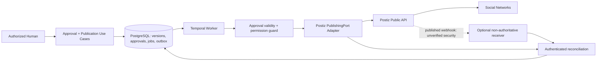

# 10 — Discovery Integrasi Postiz

**Proyek:** MenerjangBadai — AI Marketing Office<br>
**Tahap:** Phase 0; kontrak kandidat untuk Phase 5, bukan implementasi publishing<br>
**Tanggal telaah:** 6 November 2026, berdasarkan sumber resmi yang diambil 5 November 2026 UTC<br>
**Gate:** **BELUM LULUS — deployed Postiz/version/API dan keamanan webhook belum diverifikasi.**

## 1. Scope, evidence dan kesimpulan awal

Dokumen ini mengikuti `PHASE-00-DISCOVERY-AND-ARCHITECTURE.md`, `PHASE-01-APPLICATION-FOUNDATION.md`, `PHASE-03-HERMES-INTEGRATION-AND-WORKFLOWS.md`, dan `PHASE-05-APPROVAL-AND-POSTIZ-PUBLISHING.md`. **Tidak ada deployed Postiz maupun Authentik yang ditemukan dalam evidence yang tersedia untuk tugas ini.** Base URL instance, release/image digest, organization, connected channels dan credential provisioning masih unknown. Tidak dilakukan inventory infrastruktur penuh; pernyataan ini bukan klaim bahwa layanan tidak ada di seluruh host lain.

Semua endpoint/format di bawah berasal dari **published official docs**, bukan panggilan ke deployment lokal. Tidak ada credential yang dibaca/dibuat, account dihubungkan, media diunggah, webhook dikirim atau social post diterbitkan. API operations yang bersifat side effect memerlukan persetujuan manusia terpisah.

Istilah bukti:

- **Published:** didukung halaman resmi yang dibaca; tidak membuktikan tersedia pada release yang kelak dipasang.
- **Deployed:** harus ada bukti dari instance/version aktual; **belum ada** pada tugas ini.
- **Proposed:** kebijakan/adapter MenerjangBadai yang masih menunggu approval/implementasi.
- **Unverified:** kontrak belum cukup rinci/diuji; bukan otomatis unsupported.

## 2. API availability, authentication dan base URL

Published docs menamai kontrak **Public API**, dengan cloud base `https://api.postiz.com/public/v1` dan self-host template `https://<domain>/api/public/v1`. `public/v1` adalah API path; `info.version: 1.0.0` pada OpenAPI bukan bukti versi aplikasi/container yang terpasang.[4][5]

| Mode | Published contract | Implikasi proposed |
|---|---|---|
| API key | Header `Authorization: <api-key>`; **tanpa prefix `Bearer` pada contoh resmi** | Secret server-side per integration/workspace; jangan dikirim ke React/agent |
| OAuth2 app token | Authorization Code consent kepada Postiz; token `pos_...` dipakai raw pada header Authorization seperti API key | Hanya bila memang perlu akses on-behalf-of banyak pengguna/workspace |

Dua mode authentication diterbitkan pada overview; jangan menyalin format `Authorization: Bearer ...` Hermes/OIDC ke adapter Postiz hanya karena OAuth token response menyebut `token_type: bearer`.[3][18]

OAuth Postiz adalah authorization untuk **Public API Postiz**, bukan human login MenerjangBadai (Authentik) dan bukan OAuth channel provider (misalnya Meta). Dokumen OAuth menyebut token tidak kedaluwarsa, dapat dicabut lewat Approved Apps; rotating client secret tidak mencabut access tokens yang sudah ada. Perlu keputusan penyimpanan, inventory dan revocation terpisah; jangan menyimpulkan PKCE/refresh/scoped least privilege tersedia tanpa bukti versi aktual.[18]

Pilihan awal proposed: managed service integration dengan API key milik workspace yang disetujui, selama scope/ownership dan revocation dapat dibuktikan. Jangan menganggap satu key multi-brand memberi isolation otomatis. Jika multi-tenant product membutuhkan OAuth, lakukan discovery khusus consent, scopes dan ownership sebelum memilihnya.

## 3. Endpoint capability matrix

Semua path relatif terhadap **base URL yang telah divalidasi**, bukan path Go API MenerjangBadai. Seluruh baris berstatus **Published; deployed unverified**.

| Kebutuhan | Method/path yang diterbitkan | Batas/catatan |
|---|---|---|
| Connected channels | `GET /integrations` | Organization channels; field seperti `id`, `identifier`, `disabled`, `profile`, optional customer; `group` filter bukan aplikasi RBAC.[5] |
| Channel posting rules | `GET /integration-settings/{id}` | Posting rules, max content length, settings schema, provider tools.[13] |
| Connect/refresh channel | `GET /social/{integration}` | Mendapat OAuth authorization URL; hanya OAuth-based integrations, bukan semua network/external-URL providers seperti Mastodon.[14] |
| Delete channel | `DELETE /integrations/{id}` | Destructive: scheduled posts terkait juga dihapus; explicit human authorization wajib.[19] |
| Media upload | `POST /upload` | `multipart/form-data`, field `file`; response `id` dan `path`.[6] |
| Remote media import | `POST /upload-from-url` | JSON `url`; source harus bisa diakses Postiz dan memenuhi SSRF/MIME policy.[15] |
| Media processing status | `GET /media/{id}/status` | Untuk optional `adjust`; tunggu readiness dan periksa warning/error.[16] |
| Create/schedule/draft | `POST /posts` | Top-level `type`: `now`, `schedule`, `draft`; per-platform settings.[4] |
| Status/error sync | `GET /posts?startDate=...&endDate=...` | Date range wajib; optional customer; state dan platform error.[11] |
| Delete post | `DELETE /posts/{id}` | Dokumen menyebut penghapusan seluruh posts dalam group, bukan satu network item saja.[20] |
| Publish notification | UI Settings → Webhooks | HTTP callback ketika post publishes; bukan bukti callback failure/progress atau kontrak signature.[12] |

Tidak mengarang endpoint `GET /posts/{id}`, cancel-in-flight, callback registration API, idempotency header atau generic account CRUD. Jika diperlukan, cari dan verifikasi kontraknya terhadap release/instance aktual dahulu.

### Channel/account mapping

API memakai istilah **integration**, sedangkan UI menyebut **channel**; keduanya berarti akun social yang tersambung.[3]

Rancangan PostgreSQL menyimpan internal integration ID, organization/brand, Postiz workspace reference, external channel ID, provider identifier, display handle, status, credential **reference** dan waktu sync. Backend harus memastikan channel belongs-to brand/organization sebelum upload/publish/delete. Filter `group`/`customer` membantu discovery tetapi bukan authorization boundary yang cukup. Account connect/refresh/disconnect tidak boleh dilakukan agent tanpa explicit human authorization.

## 4. Media: alur yang dapat direncanakan

Published upload contract mendeteksi actual content MIME; allowlist yang disebut saat telaah: JPEG, PNG, GIF, WebP, AVIF, BMP, TIFF dan MP4. PDF tidak diterima. Ini batas upload Postiz, bukan jaminan setiap network menerima semua format tersebut.[6]

Alur proposed:

1. Pilih exact approved asset version dari MinIO melalui backend; periksa file size, MIME sniffing, malware policy, dimensions/duration dan provider-specific rules. Bucket credential tetap server-side.
2. Utamakan backend streaming download → multipart `POST /upload`, bukan mengirim private MinIO URL ke Postiz. MinIO di private network tidak otomatis dapat di-fetch Postiz.
3. Catat external media `id`/`path`, internal asset ID/version/hash dan transform metadata. Sertakan `{id, path}` dalam `posts[].value[].image[]` sesuai published contract.[6]
4. Bila memakai optional `adjust`, published docs menyebut background processing dan response `processing`; poll media status sebelum post. Warning dapat berarti original dipertahankan setelah adjustment gagal; OpenAPI juga mengenal `failed`. Perlakukan unknown status sebagai blocked, bukan siap publish.[6][16]
5. Jangan membiarkan transform material sesudah approval mengubah media tanpa review. Bila normalisasi/transcode mengubah deliverable, approval harus mengikat derived asset version yang akan dipublikasikan atau kebijakan transform eksplisit yang disetujui; jangan menganggap approval original otomatis mencakup semuanya.

`upload-from-url` mensyaratkan reachable HTTPS source dan SSRF-safe fetch yang menolak private/link-local/localhost secara default. Dokumen memperingatkan signed URL jangan kedaluwarsa sebelum fetch; upload multipart lebih aman bagi private/short-lived MinIO source. **Jangan menonaktifkan SSRF protection sebagai workaround integrasi.**[15]

Ukuran maksimal efektif, proxy request limit, video codec, per-network constraints, storage URL lifetime/reachability dan media processor availability masih harus diukur pada deployment. Overview menyebut `413` pada `/posts` untuk body di atas 50 MB, biasanya akibat base64-inline media; itu **bukan** bukti seluruh upload/network memperbolehkan file 50 MB.[3]

## 5. Scheduling, publishing dan results

Published create request mencakup `type`, `date`, `shortLink`, `tags` dan `posts` dengan `integration.id`, content/media dan provider `settings.__type`. `schedule` memakai ISO 8601 date, `now` mengabaikan date untuk waktu publish, sedangkan `draft` menyimpan tanpa menjadwalkan/publish. Response documented berupa array `postId` dan `integration`; HTTP 200/create bukan bukti network publication sudah berhasil.[4]

Contoh **payload kontrak, tidak dijalankan** untuk draft test mendatang:

```json
{
  "type": "draft",
  "date": "<UTC-ISO-8601-timestamp>",
  "shortLink": false,
  "tags": [],
  "posts": [
    {
      "integration": {"id": "<approved-test-channel-id>"},
      "value": [{"content": "<approved-test-content>", "image": []}],
      "settings": {"__type": "bluesky"}
    }
  ]
}
```

Placeholder date di atas harus diganti timestamp ISO 8601 yang valid saat authorized contract test; jangan mengirim contoh ini mentah. Provider dipilih hanya sebagai contoh schema dari docs, bukan akun/network yang ditemukan. Bahkan draft creation adalah external write dan perlu izin; tidak ada test tersebut dilakukan.[4]

Published listing memakai `startDate`/`endDate` UTC dan state `QUEUE`, `PUBLISHED`, `ERROR`, `DRAFT`, dengan `error` untuk pesan kegagalan platform serta external ID/release URL. Proposed mapping tidak menggantikan business state: `QUEUE` ≠ already published; `ERROR` memerlukan klasifikasi; `PUBLISHED` perlu ID/link/verification yang tersedia. Simpan raw external state/error teredaksi dan sync timestamp; unknown state harus terlihat.[11]

Timezone UI harus dikonversi ke UTC dan keputusan timezone/schedule disimpan sebagai bagian publication intent. Aturan future date, daylight-saving edge cases, thread/multi-channel grouping, partial success, reschedule dan kemampuan cancel aktual belum diuji. Deleting scheduled Postiz object bukan jaminan network operation yang sudah berjalan dapat dibatalkan; `DELETE /posts/{id}` berpotensi mencakup group.[20]

## 6. Webhooks: ada published capability, security contract belum lengkap

Dokumen resmi menyatakan webhook dipicu ketika post publishes, dikonfigurasi di Settings → Webhooks, dapat dipilih per channel/all integrations dan memiliki Send Test. Cloud disebut Standard ke atas dengan plan allowance; self-host unrestricted pada halaman ini.[12]

Halaman yang ditelaah **tidak menetapkan** nama header signature, algoritma, signing secret, canonical bytes, timestamp/replay window, event ID, full payload schema, retry schedule, ordering atau failure-event coverage. Ini **unverified**, bukan klaim Postiz tidak mendukung signature pada semua versi.

Phase 5 mewajibkan signature verification bila webhook dipakai. Karena kontrak tersebut belum dibuktikan:

- Jangan menulis fabricated `X-Postiz-Signature` atau meminjam HMAC contract Hermes.
- Default proposed adalah **authenticated polling reconciliation** memakai `GET /posts` pada jendela UTC yang dibatasi, backoff dan channel/ownership matching.[11]
- Bila receiver webhook diperlukan, capture authorized Send Test dari versi aktual setelah izin; dokumentasi sendiri menyarankan payload Send Test sebagai contract. Receiver harus cepat 2xx dan idempotent, tetapi jangan memperbarui authoritative business state dari event yang belum terautentikasi.[12]
- Jika signature tidak tersedia pada versi itu, nyatakan limitation; non-authoritative wake-up hint hanya boleh menyebabkan authenticated read/reconciliation, bukan publish/approve atau menerima status palsu. Guard rate, body size, replay/dedupe dan expose network tetap memerlukan review.
- Jangan membuka tunnel/public endpoint atau mengirim Send Test pada tugas discovery read-only ini. Reachability cloud vs self-host/private topology harus diputuskan secara eksplisit.

## 7. Rate limits, platform restrictions dan konflik dokumentasi

### Rate-limit discrepancy yang ditemukan

Overview saat dibaca menyebut **90 requests/hour self-host, 100 cloud, hanya create-post endpoint**, global instance value dan self-host `API_LIMIT`. Namun repeated OpenAPI `info.description` pada endpoint pages masih menyebut **30 requests/hour**. Itu konflik dalam published docs, bukan dua hasil benchmark.[3][4][5]

Jangan menetapkan throughput/worker concurrency berdasarkan salah satu angka sebagai deployed truth. Gate membutuhkan versi/image, effective non-secret limit yang dikonfirmasi owner, respons 429/headers bila tersedia, serta provider quota yang terpisah. Jangan melakukan load test atau mengubah `API_LIMIT` tanpa izin. Adapter perlu bounded queue, explicit quota configuration, backoff/jitter dan retry visibility; jangan berasumsi semua GET ikut 90/hour atau bahwa satu successful API call menjamin jumlah posts tidak dibatasi plan/platform.

### Networks dan content formats

Overview menampilkan **32 total platforms**, sementara bagian Create Post/OpenAPI masih menyebut **27** dan beberapa enums/examples tidak sepenuhnya selaras. Karena itu daftar tidak diperlakukan sebagai frozen deployment capability.[3][4][5]

Contoh published provider contracts: X `x`, LinkedIn `linkedin`/`linkedin-page`, Facebook `facebook`, Instagram `instagram`/`instagram-standalone`, TikTok `tiktok`, YouTube `youtube`, Bluesky `bluesky`, Threads, Mastodon, Telegram, Reddit, Pinterest dan beberapa blogging/community providers. Settings/content/media berbeda per network; contoh: Instagram `post_type`, YouTube `title`/`type`, TikTok privacy/direct-post/upload settings, dan content limits yang dapat diperoleh lewat integration settings.[3][4][13]

Dukungan docs bukan bukti account scope/platform review/plan/region/media format pada deployment. Buat capability registry per channel dari actual provider settings dan controlled tests; hanya network-format combinations yang lolos yang diaktifkan. Jangan menjanjikan video/reels/story/carousel/thread/alt-text untuk seluruh network berdasarkan satu generic media array.

## 8. Reliability dan error mapping (proposed)

Published overview menjelaskan HTTP 400 malformed, 401 auth, 403 ownership, 404 resource, 413 body limit, 429 quota dan 5xx server errors. Ada catatan known DELETE issue yang dapat mengembalikan 500 untuk missing post; jangan menyamaratakan seluruh 500 sebagai already deleted.[3]

| Kondisi | Perlakuan aplikasi yang diusulkan |
|---|---|
| 400 / schema/provider rule invalid | Terminal validation error; tampilkan actionable feedback; jangan blind retry |
| 401 / 403 | Block integration/operation, audit dan minta authorized repair; jangan fallback credential lain |
| 404 | Reconcile ID/workspace; hanya normalized already-deleted bila semantics versi dan operasi memang cocok |
| 413 | Stop; upload media terpisah/kurangi payload setelah review, bukan retry body identik |
| 429 | Bounded backoff, hormati Retry-After jika benar tersedia; pertahankan job identity |
| 5xx / timeout / disconnected create | **Unknown outcome** bila mungkin sudah diterima; reconcile sebelum create lagi |
| `ERROR` dari platform | Simpan external error teredaksi; klasifikasikan permanent vs transient secara provider/version-specific |

Tidak ditemukan published idempotency-key/header guarantee pada create pages yang ditelaah. Ini tidak membuktikan tidak ada dukungan lain, tetapi aplikasi **tidak boleh mengandalkannya** sampai diverifikasi. Request key internal tidak otomatis menjadi dedupe Postiz.

Rancangan:

1. PostgreSQL transaction mengikat exact content/asset/channel/schedule approval snapshot ke publication job + outbox, dengan unique internal idempotency key.
2. Temporal Activity memeriksa ulang authorization/approval validity sebelum side effect; simpan attempt ID dan payload hash sebelum submit.
3. Simpan setiap external `postId`/integration dan grouping metadata setelah response. Multi-channel partial results diperlakukan per external item, bukan satu bool sukses.
4. Setelah uncertain response, cari external state lewat authenticated polling dan known IDs bila tersedia. Date/channel/content matching tanpa unique external correlation bukan bukti dedupe yang pasti; jika ambiguous, **parkir untuk operator**, jangan create ulang otomatis.
5. Retry hanya safe subset dengan bounded policy. Outbox at-least-once dan Temporal retries tidak menjamin exactly-once social publishing.
6. Jadwalkan reconciliation periodik dan failed/unknown-outcome queue; audit requester, approver, payload version/hash, destination, schedule, attempts, external IDs dan final disposition tanpa secret.

## 9. Ports/adapters dan approval boundary



Domain tidak mengimpor Postiz HTTP/SDK atau Temporal. Application mendefinisikan publishing/status/media ports hanya saat ada use case nyata; adapter memegang HTTP path, auth, DTO mapping, provider rules dan redaction. PostgreSQL authoritative untuk content/version, asset references, approval, campaign, publication intent/internal state dan audit. Postiz authoritative hanya untuk external scheduler/provider observations; simpan IDs dan sync metadata, bukan memindahkan business truth ke Postiz.

Approval harus mengikat exact content dan asset versions, brand, intended channel/platform, publication intent/schedule, approver dan decision time. Material edit menginvalidasi approval. Task Hermes selesai tidak memicu publication. Human harus mengotorisasi publish, account changes, advertising spend, brand identity changes dan destructive operations; sensitive operations mempertimbangkan step-up menurut [08-authentication-security.md](08-authentication-security.md).

## 10. Discovery dan implementation gate yang masih terbuka

| Gate | Status sekarang | Bukti/keputusan berikutnya |
|---|---|---|
| Deployment/version/API | **Belum ditemukan/diverifikasi** | Approved base URL, release/image digest, ownership, cloud/self-host, exact API contract |
| Credential/ownership | **Pending** | Authorized service key/OAuth choice, workspace scope, revocation, positive/negative read tests tanpa secret di report |
| Channel mapping | **Pending** | Actual connected accounts, allowed brands, disabled/expired handling, settings per channel |
| Media | **Pending** | Authorized upload fixture; MIME/size/codec limits, MinIO transfer, adjustment readiness dan exact approved output |
| Scheduling/draft/create | **Pending** | Sandbox/test account, authorized draft write, UTC boundary tests, returned IDs dan response/error fixture |
| Real publishing | **Tidak dilakukan** | Explicit human approval untuk controlled publish; network result/ID, partial error dan rollback semantics |
| Webhook authenticity | **Unverified / blocker bila webhook dipakai** | Version-specific signature/payload/event/retry/replay evidence; jika tidak ada, documented authenticated polling fallback |
| Limits/platform support | **Konflik published docs** | Effective limits/provider quotas dari versi aktual dan approved capability matrix |
| Idempotency/retry/cancel | **Unverified** | No-duplicate tests, unknown-outcome reconciliation, grouped delete impact, cancel limitation |
| Phase 5 approval safeguards | **Belum diimplementasikan** | Backend tests: unapproved/cross-brand denied, exact-version approval invalidation, permission/audit coverage |

**Kesimpulan:** discovery published API menghasilkan kandidat kontrak yang dapat ditinjau, bukan Postiz integration yang berjalan. Karena deployed Postiz/Authentik belum ditemukan dan actual-version tests belum ada, gate Phase 0/5 **tidak boleh ditandai fully passed**. Langkah selanjutnya memerlukan owner approval untuk infrastructure/credentials dan controlled validation, bukan deployment atau publishing otomatis.

## Sources

[3] https://docs.postiz.com/public-api/introduction.md
[4] https://docs.postiz.com/public-api/posts/create.md
[5] https://docs.postiz.com/public-api/integrations/list.md
[6] https://docs.postiz.com/public-api/uploads/upload-file.md
[11] https://docs.postiz.com/public-api/posts/list.md
[12] https://docs.postiz.com/general/automations/webhooks.md
[13] https://docs.postiz.com/public-api/integrations/settings.md
[14] https://docs.postiz.com/public-api/integrations/connect.md
[15] https://docs.postiz.com/public-api/uploads/upload-from-url.md
[16] https://docs.postiz.com/public-api/uploads/media-status.md
[18] https://docs.postiz.com/oauth.md
[19] https://docs.postiz.com/public-api/integrations/delete.md
[20] https://docs.postiz.com/public-api/posts/delete.md
