# ADR-0004 — Temporal, outbox dan operasi eksternal idempoten

- **Status:** Proposed / menunggu persetujuan owner; belum ada workflow/service yang dijalankan.
- **Dasar:** prinsip [Phase 0](../../PHASE-00-DISCOVERY-AND-ARCHITECTURE.md), reliability [Phase 3](../../PHASE-03-HERMES-INTEGRATION-AND-WORKFLOWS.md), publishing [Phase 5](../../PHASE-05-APPROVAL-AND-POSTIZ-PUBLISHING.md), recovery [Phase 7](../../PHASE-07-PRODUCTION-HARDENING-AND-OPERATIONS.md).

## Konteks

Tugas agen, approval manusia, scheduled publishing dan metric ingestion melintasi request, restart dan layanan yang tidak ikut transaksi PostgreSQL. Database commit dan network dispatch tidak dapat dianggap atomik. Timeout mungkin terjadi setelah provider berhasil. Aplikasi harus menjaga business truth, mendeteksi duplikasi dan menjelaskan unknown outcome, bukan menjanjikan exactly-once.

## Keputusan yang diusulkan

### Satu orkestrator dan satu sumber kebenaran bisnis

**Temporal adalah satu-satunya orkestrator durable** untuk task/workflow, timer, human approval pause, cancellation/retry, publishing reconciliation dan ingestion schedule yang diaktifkan. PostgreSQL tetap authoritative untuk task/run/deliverable, versi, approval, intent/job, audit dan metrics. History Temporal hanya execution truth. Tidak menambah Celery, queue Redis, cron workflow bisnis atau scheduler aplikasi paralel.

API dan Activity sama-sama memanggil use case berizin; domain tidak mengimpor SDK Temporal. Workflow deterministic: tidak langsung SQL/HTTP, baca secret, memakai wall clock/random biasa atau membawa raw context dalam argumen/history. Activities melakukan IO lewat adapter dan port aplikasi, dengan input ID/ref minimum.

### Transaksi dan relay outbox

- Command berizin menulis state + domain/task event + audit penting + outbox dalam **satu transaksi**; respons diterbitkan setelah commit.
- Relay merupakan komponen pengiriman terbatas dalam worker: claim batch committed event dengan lease, start/signal Temporal, ack delivery. Relay tidak memanggil agen/Postiz dan tidak menentukan dependency/retry bisnis.
- Crash/redelivery berarti **at-least-once**. Workflow ID stabil dari org + operasi + task run/job ID. Unique outbox dedupe key, workflow identity dan event ID mencegah run/job baru karena pengiriman ulang.
- Relay retry hanya pengiriman ke Temporal (termasuk health/backoff), bukan second orchestrator. Jika Temporal down, pending outbox terlihat dan alert; tidak fallback synchronous dispatch lewat API.
- Mapping business run/job ke workflow/run execution Temporal disimpan untuk trace/recovery; restart workflow tidak otomatis membuat percobaan bisnis baru atau mengubah approval.

### Idempotensi dan uncertain outcome

Sebelum side effect, Activity reserve external operation unik pada PostgreSQL dengan provider connection, operation type, idempotency key dan request hash. Duplicate key+same hash mengembalikan state/receipt sebelumnya; key sama+hash berbeda adalah conflict. Tidak menahan transaksi DB saat network call.

Gunakan external idempotency key hanya bila capability provider dibuktikan. Local ledger saja tidak menjamin external exactly-once ketika crash setelah submit. Jika timeout/crash terjadi sesudah kemungkinan penerimaan, tandai **unknown**, hentikan auto-resubmit dan reconcile dengan lookup/callback/polling yang didukung. Bila provider tidak memberi cara membuktikan hasil, minta penanganan manusia; jangan membuat output palsu atau posting/tugas ganda.

Activity retry dikelompokkan: transient aman dengan backoff/batas, permanent validation/permission/unsupported tanpa retry, dan ambiguous side effect yang memerlukan reconcile. Timeout, schedule-to-close/start-to-close, heartbeat, cancellation dan retry budget per jenis operasi harus dipilih setelah capability/beban diketahui, bukan satu default tanpa batas.

### Approval dan otorisasi tetap pada business store

Approval human tersimpan terhadap immutable publication intent: exact content/asset versions, tujuan, format, jadwal dan publication mode. Konfirmasi publisher manusia terpisah membuat job+outbox. Sinyal Temporal hanya memberi tahu bahwa fakta approval/confirmation berubah; workflow/Activity membaca record authoritative dan memeriksa permission/grant/revocation terbaru sebelum aksi sensitif.

Agen selesai tidak otomatis publish. Material change memerlukan intent/approval baru. Duplicate/delayed approval signal tidak boleh mengotorisasi versi lain. Revocation setelah external provider menerima perlu cancel/update capability atau escalation; tidak dapat diselesaikan rollback lokal.

### Inbox dan event ordering

Authenticated callback atau polling result dipetakan ke org/brand/connection/run dari data server, bukan dipercaya dari payload. Unique inbox key per connection/provider event, payload hash conflict detection, lock/optimistic transition dan append history mencegah duplicate/out-of-order merusak terminal state. Event stale disimpan sebagai late observation, bukan menghidupkan kembali task cancelled atau menimpa assignment baru. Bila webhook signature tidak tersedia/terbukti, pilih polling terautentikasi yang aman atau blokir feature; jangan menerima webhook anonim sebagai bukti publikasi.

## Diagram transaksi dan recovery

```mermaid
flowchart LR
    C[Command berizin] --> TX[PostgreSQL TX
business, audit, outbox]
    TX --> R[Relay claim dan lease]
    R -->|at-least-once, workflow ID stabil| T[Temporal deterministic workflow]
    T --> A[Activity dan use case]
    A --> L[Operation ledger reserve]
    L --> E[Adapter eksternal]
    E -->|receipt terbukti| S[Simpan observed outcome]
    E -->|timeout ambigu| U[Unknown, tahan resubmit]
    U --> Q[Reconcile atau human escalation]
    Q --> S
    S --> TX2[TX status, history, audit dan outbox]
```

## Alternatif yang dipertimbangkan

| Alternatif | Mengapa tidak dipilih |
|---|---|
| Dispatch langsung setelah HTTP commit tanpa outbox | Crash window kehilangan pekerjaan; retry client bisa menggandakan |
| DB transaction terbuka selama provider call | Lock lama tidak membuat transaksi lintas provider atomik; ambiguity tetap ada |
| Redis queue/cron sebagai workflow engine kedua | Kepemilikan retry/timer/recovery tumpang tindih dan menyulitkan audit |
| Temporal menggantikan record approval/task di PostgreSQL | Business query, integrity FK dan otorisasi tidak boleh bergantung pada history runtime |
| Exactly-once karena unique key lokal | Tidak mencakup side effect provider yang tidak transaksional/idempoten |
| Retry setiap error atau timeout | Memungkinkan duplicate task/post; ambiguous harus direkonsiliasi |

## Konsekuensi dan beban operasi

Temporal memerlukan persistence, kapasitas, namespace/task queue policy, backup/recovery dan compatibility rollout. Workflow replay/versioning tests diperlukan untuk perubahan kode; sticky old execution tidak boleh rusak saat API-worker upgrade. Pilihan deployment self-hosted/managed, history retention/encryption, limits/concurrency, metric/alert dan availability target menunggu owner/capacity gate.

PostgreSQL dan Temporal dapat sementara berbeda dalam progress; UI membaca business state dan observed workflow status terpisah, tidak mengganti state bisnis mentah dari history. Reconciliation serta audit diperlukan untuk memulihkan perbedaan. Secret/prompt/raw output tidak boleh masuk history/log; simpan ID/ref dan ambil data berizin di Activity.

## Acceptance yang harus dibuktikan kemudian

- State/outbox/audit rollback bersama; crash relay sebelum/selesai ack dan duplicate start tidak membuat run/job baru.
- Worker/Temporal restart memulihkan flow dan human approval pause; replay/version migration diuji.
- Repeated Activity, malformed Hermes output, timeout unknown dan delayed/cancelled callbacks tidak menghasilkan duplicate/invalid transition.
- Exact approval, grant dicabut dan concurrent edit/confirmation ditolak sebelum submit; external uncertain outcome tidak blind retry.
- Postiz status, cancel, webhook/polling dan idempotency diuji terhadap versi/API aktual; tanpa capability tertentu, feature dibatasi secara eksplisit.
- DB/MinIO/Temporal recovery, restore dengan dispatch ditahan, alert backlog/unknown/failed operations dan runbook reconciliation dibuktikan Phase 7.

Owner perlu menyetujui deployment Temporal/capacity dan batas biaya/retry/retention, recovery targets serta kebijakan privilege revocation untuk pekerjaan aktif. Blueprint approval tidak mengizinkan install/deploy atau publish nyata. Detail [data flow](../architecture/data-flow.md), [database](../06-database-design.md), [domain](../05-domain-model.md) adalah bagian dari keputusan ini.
