# Diagram komponen Go modular monolith

> **Usulan Phase 0.** Komponen menunjukkan tanggung jawab dan arah dependensi; bukan package yang sudah dibuat.

```mermaid
flowchart TB
    subgraph Inbound[Inbound adapters]
        HTTP[HTTP handlers dan middleware
OIDC callback, session, CSRF]
        Callback[Webhook atau polling ingest
authentication dan inbox dedupe]
        Activity[Temporal Activity handlers]
    end
    subgraph App[Application use cases - semua jalur melewati policy]
        Policy[AuthorizationPolicy
org membership, permission, brand grant]
        Identity[Login, session, invitation dan revoke]
        Brands[Brand dan Agent Registry]
        Work[Create/assign task, run dan deliverable]
        Context[Build authorized context snapshot]
        Content[Knowledge, asset, campaign dan content version]
        Publish[Review, confirm, dispatch dan reconcile]
        Analytics[Metric ingestion dan BI access]
        Tx[UnitOfWork, audit dan outbox]
    end
    Domain[Domain entities dan invariants
transition, exact versions, approval, intent]
    Ports[Outbound ports milik application
scoped repositories, identity, agent, object, publisher, metrics, BI]
    subgraph Outbound[Outbound adapters]
        PG[PostgreSQL pgx dan sqlc]
        OIDC[Authentik OIDC dan session store]
        Agent[Hermes native gateway verified subset]
        Object[MinIO private object store]
        Publisher[Postiz verified subset]
        Metrics[Platform-specific metrics source]
        BI[Superset guest-token issuer]
    end
    HTTP --> Identity
    HTTP --> Brands
    HTTP --> Work
    HTTP --> Content
    HTTP --> Publish
    HTTP --> Analytics
    Callback --> Work
    Callback --> Publish
    Callback --> Analytics
    Activity --> Work
    Activity --> Context
    Activity --> Content
    Activity --> Publish
    Activity --> Analytics
    Identity --> Policy
    Brands --> Policy
    Work --> Policy
    Context --> Policy
    Content --> Policy
    Publish --> Policy
    Analytics --> Policy
    Policy --> Ports
    Work --> Domain
    Content --> Domain
    Publish --> Domain
    Work --> Tx
    Content --> Tx
    Publish --> Tx
    Analytics --> Tx
    Tx --> Ports
    Identity --> Ports
    Brands --> Ports
    Context --> Ports
    Analytics --> Ports
    PG -.implements.-> Ports
    OIDC -.implements.-> Ports
    Agent -.implements.-> Ports
    Object -.implements.-> Ports
    Publisher -.implements.-> Ports
    Metrics -.implements.-> Ports
    BI -.implements.-> Ports
```

## Boundary yang harus dipertahankan

- Panah ke `Ports` menunjukkan dependency compile-time; concrete adapter mengimplementasikannya. Runtime call dirakit di composition root `cmd/api` dan `cmd/worker`. Domain tidak mengimpor port IO atau SDK vendor.
- Authorization bukan hanya middleware HTTP. Activities, webhook/polling transition, download grant, context, search/export dan BI issuer melewati policy use case yang sesuai. Callback tidak mempunyai human publishing permission hanya karena signature valid.
- UnitOfWork mengikat state, audit keamanan/bisnis dan outbox pada transaksi yang sama. `sqlc` generated row tidak keluar ke domain atau frontend.
- Agent gateway mengirim task ke profil existing yang sudah dipetakan allowlist; tidak mengandung prompt personality pengganti, tidak shell-interpolate ID/payload, tidak memberi akses path profil dari input user.
- Context builder merekam sumber/versi dan mengecek brand grant, task delegation, classification serta approved/draft policy. Object storage tidak melewati policy hanya karena object key dapat ditebak.
- Workflow deterministic Temporal berada di sisi adapter runtime dan memanggil Activities, bukan SQL/HTTP langsung. Relay membaca outbox lalu start/signal; tidak mengeksekusi publisher atau agen.

## Failure isolation yang diharapkan

Use case mengembalikan error typed (validation/forbidden/conflict/transient/permanent/unknown outcome). Handler memetakan kode API aman; worker mengklasifikasi retry sesuai policy, bukan semua error diulang. Provider malformed result diarsipkan secara privat dan diberi validation status; tidak menjadi domain object valid otomatis. Setiap langkah membawa correlation/run/job ID, tetapi tidak menambahkan secret/prompt ke telemetry.

Tes boundary import, scoped repository, concurrency approval dan crash recovery menjadi acceptance implementasi; diagram ini belum membuktikan hasil pengujian tersebut. Lihat [rincian kontrak hexagonal](../03-hexagonal-architecture.md) dan [ERD](../06-database-design.md).
