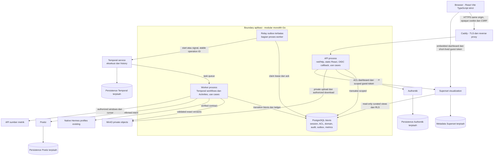

# Diagram container dan sumber kebenaran

> **Usulan Phase 0.** Istilah container di sini berarti unit runtime/C4, tidak menyatakan Docker telah tersedia atau dijalankan.

## Per proses

| Runtime | Tanggung jawab | Rahasia dan akses |
|---|---|---|
| Browser | UI, session expiry, state loading/error, confirmation manusia; tidak memutuskan hak | Tidak menyimpan OIDC long-lived token/localStorage; guest BI token singkat di memori untuk embed sesuai SDK terverifikasi |
| Caddy | TLS, routing ke Go setelah cutover disetujui, header/proxy policy | Tidak membaca credential provider, tidak mengubah brand policy |
| Go API | Input, OIDC/sesi, CSRF, authorization, transaksi use case, file grants, guest-token issuance | Minimal role DB, server OIDC/BI credential; log teredaksi |
| Go worker dan relay | Workflow deterministic + Activities, context builder, operation ledger, outbox delivery | Task-scoped delegation; provider secret hanya di Activity/adapter, bukan history workflow |
| PostgreSQL bisnis | Seluruh record authoritative, constraint, outbox, inbox dan audit | API/worker/migrator/analytics punya role terpisah |
| Vendor services | Tugas khusus masing-masing | Database/role vendor terpisah; UI/admin internal/trusted, bukan publik tanpa jalur terlindungi |

Persistence vendor dapat berada di instance PostgreSQL yang sama hanya jika kapasitas dan isolasi role/database terbukti; diagram bukan kewajiban menjalankan empat server DB. Infrastruktur managed/host lain merupakan alternatif setelah capacity gate. Aplikasi tidak mengakses tabel internal vendor.

Redis sengaja tidak muncul pada critical path. Jika cache/rate-limit terdistribusi terbukti perlu, tambahkan opsional setelah ADR dan tes outage; PostgreSQL sessions, outbox dan Temporal tetap menentukan correctness. Tidak ada Redis workflow queue atau scheduler bisnis lain.

## Readiness dan degradasi

API readiness sesuai dependensi wajib mode yang diaktifkan; UI dapat menampilkan provider unavailable tanpa memalsukan status ready. Temporal unavailable membuat pekerjaan tersimpan pending/outbox, bukan fallback dispatch langsung dari API. MinIO unavailable menolak upload/download terkait, bukan menghapus metadata. Superset/source outage ditandai freshness warning; tidak membuat metrik nol. Timeout provider dengan hasil belum diketahui masuk rekonsiliasi.

Kontrak transaksi dan failure scenarios: [data flow](data-flow.md), [ADR workflow](../adr/ADR-0004-workflow-orchestration.md). Pembagian package: [hexagonal](../03-hexagonal-architecture.md).
