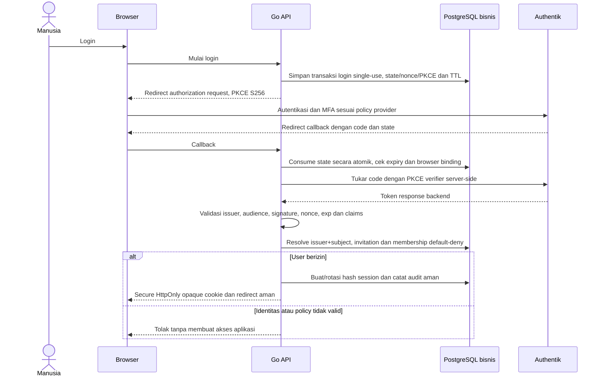
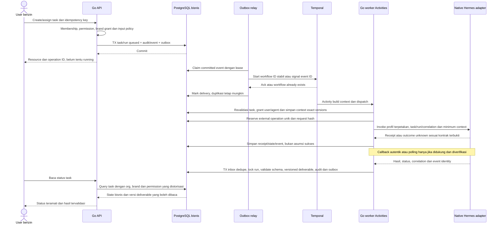
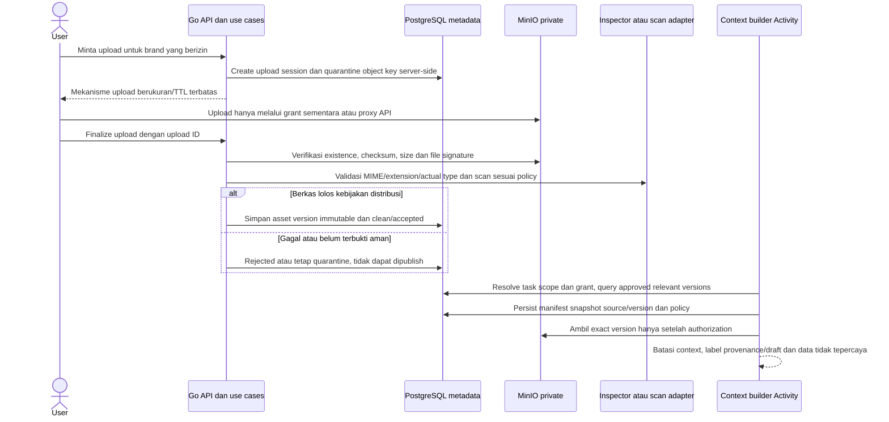
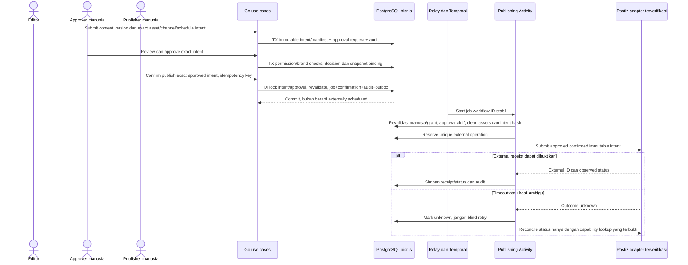
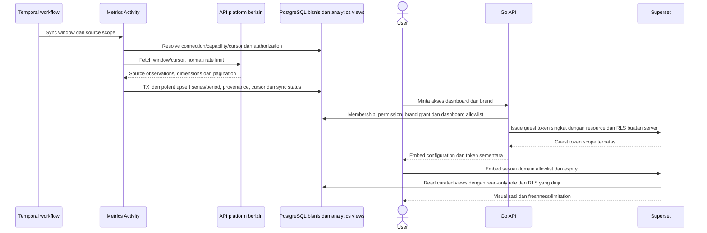

# Alur data dan jaminan kegagalan

> **Usulan Phase 0.** Alur menggambarkan kontrak yang akan diuji, bukan hasil integrasi hidup. PostgreSQL adalah business truth; Temporal adalah satu-satunya orkestrator. Nama operasi bersifat konseptual, bukan endpoint vendor yang diklaim ada.

## 1. Login backend dan sesi opaque

Redirect/return URL harus allowlist lokal; state browser binding mencegah login CSRF. Cookie produksi host-only Secure/HttpOnly, SameSite Lax atau lebih ketat jika kompatibel; CSRF token + Origin check untuk request mutasi, expiry idle/absolute, revocation server-side, rotasi setelah login/privilege change. OIDC token tidak dikirim ke JavaScript/localStorage. Logout aplikasi mencabut sesi lebih dahulu; logout provider bergantung konfigurasi yang diverifikasi dan tidak dijanjikan global single logout.

## 2. Tugas, outbox, Temporal dan hasil agen

User membaca melalui API scoped, bukan akses DB langsung. Callback HTTP sebenarnya melalui inbound adapter yang mengautentikasi dan memanggil use case sama; polling dilakukan Activity dengan policy timeout/rate limit. Tidak mengklaim mekanisme itu sudah tersedia untuk keenam profil. Jika hanya subset terbukti, capability lainnya disabled dan tidak tampil ready.

Activity timeout tidak berarti agen gagal atau belum bekerja. Bila native operation tidak mendukung idempotency/query hasil, jangan melakukan resend otomatis setelah ambiguous outcome. Rekonsiliasi atau human escalation dibutuhkan. Cancellation bisnis dicatat terpisah dari konfirmasi agen berhenti. Out-of-order hasil run superseded/cancelled disimpan sebagai late event tanpa menghidupkan task kembali. Workflow history membawa ID/ref, bukan raw context/token.

## 3. Upload dan authorized context

Presigned upload bukan public bucket; finalize tidak mempercayai metadata browser. Batas size/type/checksum diverifikasi server, URL singkat tidak disimpan permanen, private downloads mengecek grant baru. Pilihan proxy upload vs presigned bergantung jaringan browser, CORS dan capability MinIO terverifikasi. Aset belum clean tidak masuk preview bersama, context agen, atau publishing. Search awal ordinary indexed search; vector retrieval bukan default.

## 4. Exact approval, konfirmasi manusia dan Postiz

Approval tidak otomatis dispatch. Material edit membuat content/asset/intent baru; decision lama tidak berpindah. Revoke/privilege change diperiksa sebelum submit, tetapi race setelah penerimaan provider membutuhkan cancel/update capability atau eskalasi, bukan klaim transaksi lintas sistem. Postiz auth, endpoint, webhook signature, retry/idempotency, platform format dan status API harus dibuktikan terhadap versi aktual; diagram tidak mengarang endpoint. Webhook/polling hasil melewati authenticated inbox/dedupe dan policy seperti alur tugas. Tidak mengulangi submit ketika outcome unknown kecuali bukti rekonsiliasi mengizinkan.

## 5. Ingestion metrik dan embed Superset

Browser tidak menentukan SQL RLS, token admin atau arbitrary dashboard ID. Token guest hanya resource dan brand yang dihitung server, expiry singkat, renewal kembali melalui authorization. Source ingestion bukan fungsi Superset. Metrik unavailable tetap missing, bukan nol; definisi/grain/organic-paid/attribution/timezone dipertahankan. Reports membedakan measured fact dari interpretasi AI.

## Kontrak recovery lintas alur

| Titik kegagalan | Respons desain |
|---|---|
| DB rollback sebelum outbox commit | Tidak dispatch; client dapat retry command dengan key sama |
| Relay crash sesudah start sebelum ack | Redelivery dengan workflow/event ID sama; tidak create run/job baru |
| Activity crash setelah side effect | Ledger pending/unknown; query/reconcile, tidak mengasumsikan belum dieksekusi |
| Duplicate/out-of-order callback | Inbox unique key, correlation mapping, lock/version transition; terminal state tidak mundur |
| Approval atau grant dicabut | Tolak side effect baru; yang sudah diterima provider harus direkonsiliasi/cancel sesuai capability |
| Worker/Temporal restart | History/replay dan outbox memulihkan proses; PostgreSQL tetap business truth |
| Restore dari backup | Dispatch ditahan, pulihkan DB/object/key konsisten, reconcile provider sebelum resume |

Semua jalur wajib safe error/log redaction, correlation ID, scoped ACL dan audit. Reliability tests Phase 3/5/7 harus menghasilkan bukti nyata; diagram ini bukan pengganti uji.
