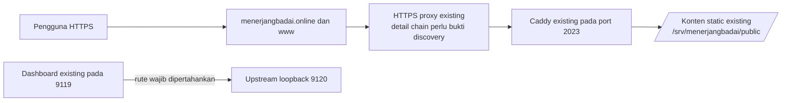
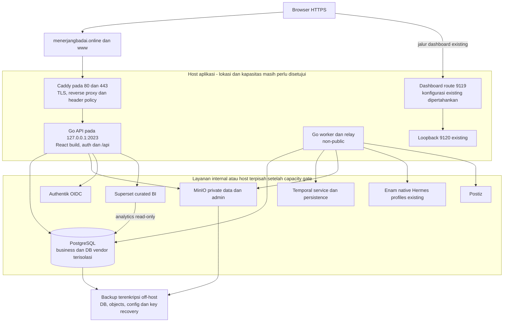

# Diagram deployment: kondisi masukan dan target bersyarat

> **Usulan Phase 0; tidak mengubah listener, proxy, filesystem produksi atau layanan.** Kondisi awal berikut berasal dari handoff discovery, bukan live probe ulang oleh penulis blueprint. Baseline repo `650134c` sendiri belum berisi aplikasi.

## Kondisi yang harus dipertahankan sampai cutover disetujui

Port `2023` sudah terpakai. Jangan menjalankan Go pada port yang sama, mengubah domain, menghapus konten static, atau menghentikan proses existing untuk membuktikan proposal. `www` harus tetap konsisten; rute dashboard `9119 → loopback:9120` tidak ikut direlokasi. Mekanisme TLS/proxy chain, bind publik vs loopback, firewall dan kepemilikan proses perlu bukti inventory terpisah.

## Target sesudah Phase 7 dan approval cutover terpisah

Admin PostgreSQL/Redis/MinIO/Temporal/Superset tidak boleh diekspos publik tanpa jalur protected yang direview. Browser redirect ke Authentik, guest embed Superset dan upload presigned MinIO memerlukan **data/user-facing route khusus yang diizinkan** melalui HTTPS proxy bila dipakai; diagram internal tidak berarti browser dapat mengakses private address. Path/subdomain, TLS, callback/issuer consistency, CSP frame ancestors/connect-src, storage CORS dan cookie policy diputuskan setelah capability aktual terbukti. Prefer same-origin app; jangan membuka admin UI hanya untuk mengatasi iframe/upload.

Docker Compose adalah kandidat yang diwajibkan dievaluasi oleh fase, bukan instalasi yang diasumsikan tersedia. Docker belum ada menurut handoff; tidak ada instalasi pada Phase 0. Go loopback pada host memerlukan mapping Compose ke `127.0.0.1:2023` jika memakai container; bind `127.0.0.1` di dalam container saja tidak otomatis dapat dijangkau proxy host. Detail network diputuskan dan diuji di lingkungan aman.

## Gate kapasitas dan placement

Sebelum co-location, ukur CPU/RAM/swap, disk/IOPS/free inode, growth objek/history/metrics, beban Hermes existing, resource PostgreSQL/Temporal/Superset, jumlah worker, concurrency, dependency versions dan headroom. Jangan menjumlahkan image service lalu menyatakan VPS cukup. Keputusan owner: pindah sebagian service/managed service, disk/storage quota, limits, concurrency, backup storage, SLO/RPO/RTO dan biaya. Redis tidak wajib; jangan menghabiskan kapasitas untuk cache yang belum dibutuhkan.

## Urutan rilis dan rollback yang wajib dibuktikan nanti

1. Owner menyetujui blueprint Phase 0, bukan produksi. Implementasi Phase 1–6 dan validasi integrasi berjalan di lingkungan terpisah dengan test data; tidak posting ke akun produksi.
2. Phase 7 membuktikan isolation/secret scan, pipeline, backup **restore**, load/capacity, observability, failure recovery, migration compatibility dan rollback. Tetapkan target terukur bersama owner.
3. Owner menyetujui production readiness **dan** perubahan route/bind 2023 secara eksplisit. Persiapkan artifact API+UI berpasangan, konfigurasi/secret terkelola, backup teruji serta rollback config/static existing.
4. Validasi config proxy dan konflik listener tanpa switch, gunakan staging atau listener alternatif yang disetujui; jangan mengasumsikan port alternatif tersedia atau boleh dibuka.
5. Pada window cutover yang disetujui, transfer kepemilikan port 2023 tanpa bind overlap, pasang Caddy 80/443 sesuai proposal, uji utama/`www`, login/callback/cookie/CSRF, API, upload, worker, dan regresi dashboard 9119→9120. Rilis gagal harus dapat kembali ke artifact/config/routing lama tanpa migrasi destruktif.
6. Merge owner ke `main` hanya trigger rilis eligible bila CI dan gate release terpenuhi; docs-only merge bukan switch produksi. Approval release pertama/cutover terpisah tidak boleh digantikan auto-deploy setiap push. Pause publishing/dispatch saat rollback dan reconcile external outcomes sebelum resume.

Tidak ada langkah tersebut yang dijalankan oleh dokumen ini. Bukti live, data capacity, target pemulihan dan siapa yang menyetujui tetap harus dilengkapi workstream discovery/operations.
