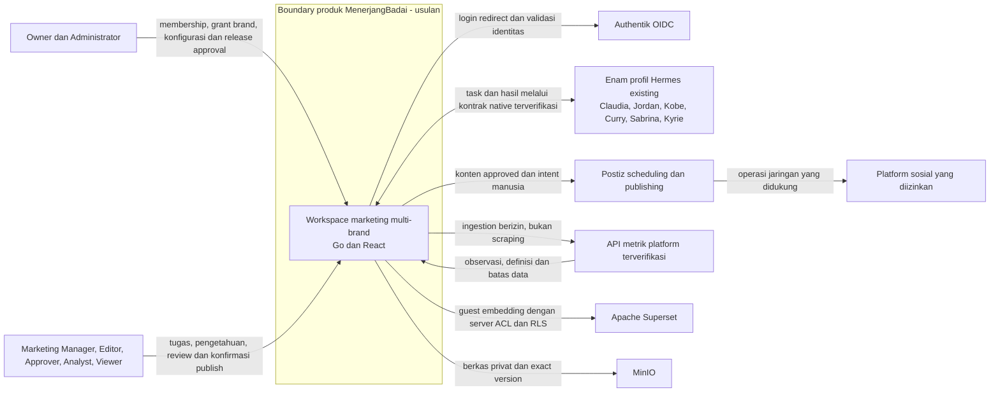

# Diagram konteks sistem

> **Usulan Phase 0, bukan gambaran deployment yang sudah berjalan.** Boundary produk mengikuti seluruh delapan dokumen fase; detail keputusan ada di [ikhtisar](../02-architecture-overview.md).

## Makna boundary dan trust

- Manusia memperoleh permission org dan brand terpisah. Owner menyetujui blueprint, readiness dan perubahan produksi; ini bukan approval yang dapat digantikan agen.
- Enam Hermes adalah profil native yang sudah ada. Diagram tidak menyatakan API atau callback mereka sudah terbukti dan tidak mengasumsikan Telegram bot dapat saling mengirim tugas. Tidak ada enam prompt-agent baru dalam aplikasi.
- Authentik membuktikan identity, bukan membership atau brand ACL bisnis; user tak dikenal ditolak kecuali invitation/provisioning yang disetujui.
- Postiz menerima intent yang disahkan backend, bukan menjalankan approval. Keberhasilan agen tidak menyebabkan publikasi. Social credentials tidak diserahkan ke browser atau konteks agen.
- Superset memvisualisasikan curated metrics; adapter sumber pada MenerjangBadai mengumpulkan data. Tampilan terfilter bukan bukti row isolation; backend dan BI RLS harus diuji.
- MinIO menyimpan binary privat. Metadata, ACL, versi, task, approval, intent, publikasi internal dan provenance tetap authoritative di PostgreSQL bisnis (lihat [container](container-diagram.md)).
- Seluruh hasil eksternal, webhook, dokumen dan keluaran agen dianggap input tidak tepercaya: validasi schema, autentikasi, dedupe, provenance dan policy mutakhir sebelum transition.

## Di luar lingkup/yang belum diverifikasi

Tidak ada public autonomous publishing, spend otomatis, default RAG, semua-platform analytics, atau asumsi semua layanan sudah aktif. Invocation/result/cancel Hermes, Postiz API versi aktual, Authentik client/discovery, embedding Superset, API sosial dan kapasitas VPS menjadi gate discovery masing-masing. Layanan yang belum dibuktikan tidak boleh tampil sebagai ready. Batas teknis dan risiko: [overview](../00-project-overview.md#risiko-utama-dan-mitigasi-desain).
